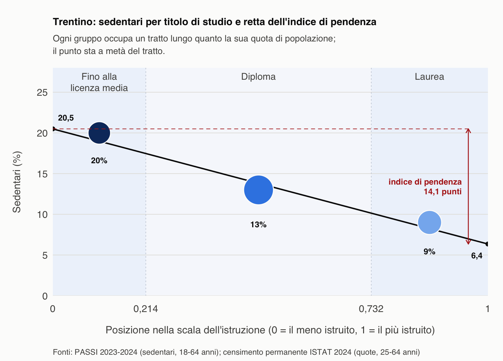
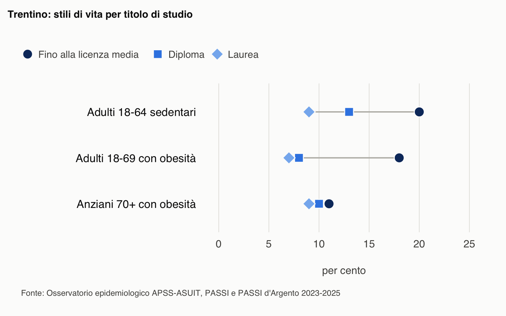
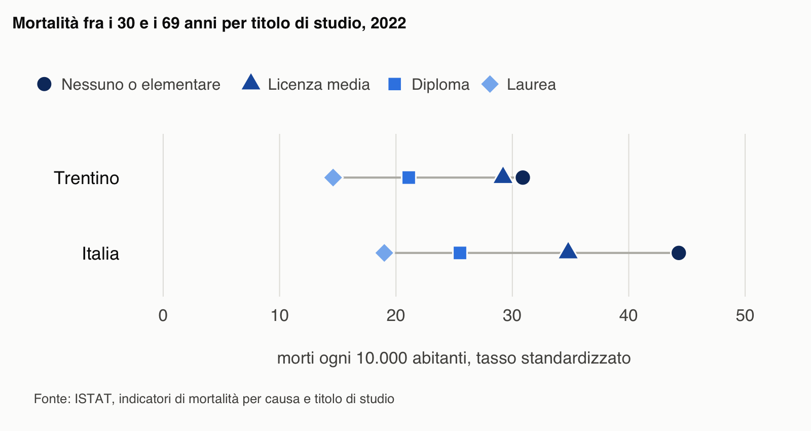

# I materiali

Accanto al libro ci sono i dati, i fogli elettronici e i programmi in R per rifare tutti i calcoli, con le istruzioni passo per passo. Sono gratuiti e stanno su Zenodo, un archivio pubblico per la ricerca che li conserva in modo permanente, a questo indirizzo:

**[indirizzo dei materiali da completare]**

L'indirizzo si scrive nella barra del browser, su un computer. Nella pagina che si apre c'è un file compresso (`.zip`) con tutto il contenuto: lo si scarica, e un doppio clic lo apre in una cartella. I materiali di questo libro stanno nella cartella `1 - Lo sappiamo già`, sotto `Materiali`. Si comincia dal file `LEGGIMI.md`, che spiega anche come installare i programmi gratuiti che servono; poi c'è una cartella per ogni capitolo con dei calcoli da rifare, da `capitolo-2` a `capitolo-6`, e il testo di quei capitoli dice quale aprire.

L'archivio è di tutta la collana Sociologizzando: via via che usciranno altri volumi, il file compresso conterrà anche i loro materiali. L'indirizzo porta sempre alla versione più recente, con le eventuali correzioni.

Se l'indirizzo non funzionasse, basta cercare «Sociologizzando» su zenodo.org. Gli stessi materiali sono anche su GitHub, il sito dove si pubblicano i programmi: <https://github.com/LuoJix/sociologizzando>.

# 1. Sapere e poter misurare

*Perché misurare una cosa nota, a chi serve questo tutorial e che cosa contiene*

Che chi ha studiato di meno, o arriva a fine mese con fatica, si ammali prima e muoia prima, lo sappiamo. Lo sa la letteratura internazionale da decenni; lo sanno i medici di famiglia, che lo vedono in ambulatorio; lo sa chiunque abbia guardato con attenzione il proprio paese. In Italia lo ha documentato con più costanza di tutti il gruppo di epidemiologia di Torino guidato da Giuseppe Costa, che segue le storie di salute dei torinesi, con dati che risalgono al 1971, incrociandole con la loro condizione sociale, e che nel 2014 ha firmato con altri *L'equità nella salute in Italia*, il rapporto da cui chiunque si occupi del tema dovrebbe partire.

L'ISTAT, intanto, pubblica i numeri anno per anno. Nel 2022, in Italia, fra i 30 e i 69 anni, chi non aveva alcun titolo di studio o aveva la sola licenza elementare è morto 2,3 volte più spesso di un laureato, a parità di età.

Eppure, negli ultimi anni, è un argomento che mi sembra parecchio trascurato, quando non ritenuto marginale: se ne parla poco, e quasi mai con i numeri. È per questo che me ne occupo.

Un tutorial per misurare una cosa che sappiamo già può sembrare superfluo.

## Dire di quanto

Sapere che una disuguaglianza esiste e poter dire di quanto è cambiata sono due cose diverse, e la seconda è quella che serve a chi governa. Un piano di prevenzione che si propone di ridurre le disuguaglianze deve poter dire, alla fine, se le ha ridotte: di quanto, per chi, rispetto a quando. Per farlo servono un indicatore, una misura, un valore di partenza e il modo in cui è costruito il numero, messo per iscritto perché chiunque possa rifare il calcolo.

Il lavoro di Costa e del suo gruppo si basa su dati che collegano, persona per persona, il censimento, l'anagrafe e le cause di morte: è ricerca di prima qualità, ed è possibile solo dentro un servizio epidemiologico. Questo tutorial sta un gradino più in basso, e lo dichiara: mostra che cosa si può fare in autonomia, con i dati che chiunque può scaricare da internet, gli strumenti gratuiti dell'Organizzazione mondiale della sanità e un foglio elettronico. Non sostituisce la ricerca; aiuta chi non la fa a leggerla e a controllarne i numeri.

## Quarant'anni dopo Ottawa

Questo libro esce nel novembre 2026, quarant'anni dopo la Carta di Ottawa per la promozione della salute, presentata il 21 novembre 1986 dalla prima Conferenza internazionale sulla promozione della salute e pubblicata dall'Organizzazione mondiale della sanità. Prima di arrivare agli stili di vita, la Carta dice che cosa serve per stare bene. Nella traduzione italiana, che curai per la Provincia autonoma di Trento: «Condizioni e risorse fondamentali della salute sono: la pace, la casa, l'istruzione, il cibo, il reddito, un eco-sistema stabile, la continuità delle risorse, la giustizia e l'equità sociale».

L'equità e la giustizia sociale stanno nell'elenco accanto al cibo e alla casa, come condizioni della salute. Nello stesso elenco ci sono l'istruzione e il reddito, le due dimensioni con cui questo libro divide la popolazione in gruppi.

L'elenco è ancora il riferimento di chi in Italia si occupa di promozione della salute. Il Manifesto della Società italiana per la promozione della salute lo riprende, con qualche aggiunta, e chiede di ridurre le disuguaglianze di salute «tra gruppi sociali e aree geografiche», cioè fra le persone, come nel capitolo 5, e fra i territori, come nel capitolo 4.

In quarant'anni l'equità è entrata nei piani della prevenzione come obiettivo dichiarato; il capitolo 8 racconta come. Un anniversario si celebra; un prerequisito si controlla, e per controllarlo bisogna misurarlo.

## Quali disuguaglianze, e come le si riconosce

Nell'originale inglese la Carta chiama le condizioni del suo elenco *prerequisites*, prerequisiti della salute; la traduzione italiana dice «requisiti». L'epidemiologia parla di determinanti della salute, e con questo nome si trovano nella letteratura e in qualche pagina di questo libro: sono le condizioni che, prima e fuori delle cure, rendono più o meno probabile ammalarsi e morire presto, dal reddito alla casa, dall'istruzione all'aria che si respira.

Questo libro tratta soltanto dei prerequisiti socio-economici, cioè della posizione delle persone, o dei territori in cui vivono, nella scala sociale. Non tratta di quelli ambientali, come l'inquinamento dell'aria e dell'acqua; non tratta nemmeno delle differenze fra uomini e donne o fra cittadini italiani e stranieri. Gli strumenti sarebbero gli stessi, ma ogni dimensione chiede fonti e ragionamenti propri, e ho preferito seguire un filo solo fino in fondo.

La condizione socio-economica di una persona non si osserva direttamente. La si stima con indicatori indiretti, che in inglese si chiamano *proxy*, «sostituti», perché stanno al posto di ciò che non si può misurare. La letteratura ne descrive diversi: il titolo di studio, il reddito, l'occupazione, la casa. Io uso i primi due, perché sono quelli che si trovano nelle fonti pubbliche descritte nel capitolo 3.

Il titolo di studio (capitoli 3, 5 e 6) ha due pregi. Lo hanno tutti, anche chi non lavora o non ha un reddito proprio. E di solito si completa da giovani, quindi una malattia dell'età adulta non lo cambia (una malattia dell'infanzia sì, perché può interrompere gli studi). Per questo, quando titolo di studio e salute vanno insieme, è difficile che sia la salute adulta a decidere il titolo. Il reddito invece può scendere proprio perché ci si ammala.

Il reddito entra nel libro in due forme, e nessuna delle due è il reddito della singola persona. Nel capitolo 4 è il reddito medio dichiarato al fisco dai contribuenti di ogni comune, e descrive il territorio più che chi ci vive. Nel capitolo 5 sono le difficoltà economiche che gli intervistati di PASSI dichiarano, cioè un giudizio su come si arriva a fine mese, non una cifra. Sono due approssimazioni diverse, e ciascuna è dichiarata dove la si usa.

## A chi serve

A chi lavora in un'azienda sanitaria, in un osservatorio epidemiologico, in un ufficio di programmazione, e vuole un percorso pratico per costruire indicatori di disuguaglianza sul proprio territorio. A chi siede in un consiglio comunale o regionale, in un sindacato, in un'associazione, e vuole sapere quali domande fare e quali risposte pretendere. A chi scrive di sanità e vuole controllare un numero prima di citarlo.

Non serve saper programmare. Quasi ogni calcolo è spiegato anche per il foglio elettronico; per chi vuole usare il software statistico R ci sono i programmi, raccolti a parte insieme ai dati. Serve un po' di pazienza con le tabelle.

## Gli strumenti

Il metodo è quello dell'Organizzazione mondiale della sanità, che per misurare le disuguaglianze di salute ha messo a punto un insieme di strumenti chiamato HEAT (*Health Equity Assessment Toolkit*, «strumenti per valutare l'equità in salute»). Sono tutti gratuiti, ma i nomi si somigliano, e conviene metterli in ordine subito.

Il lavoro ha sempre due tempi. Prima si preparano i dati: una tabella con una riga per gruppo, per esempio «laureati, sedentari, 9%, e quanti sono i laureati». Poi un programma legge la tabella e calcola le misure e i grafici.

| Che cosa si fa | Con quale strumento | Di chi è |
|---|---|---|
| Preparare i dati, una riga per gruppo | il modello in Excel dell'OMS, che controlla da sé gli errori; oppure un qualunque foglio elettronico | OMS |
| Calcolare le misure e disegnare i grafici, con finestre e pulsanti | HEAT Plus, per ora solo per Windows | OMS |
| Calcolare le stesse misure scrivendo le istruzioni | `healthequal`, un pacchetto (cioè un'aggiunta da installare) per il programma statistico R; funziona anche sul Mac | OMS |
| Capire i calcoli facendoli a mano | i fogli elettronici e i programmi in R preparati per questo tutorial | questo tutorial |

Tre precisazioni evitano gli equivoci più comuni.

HEAT Plus non funziona dentro Excel. È un programma a sé, che si scarica dal sito dell'OMS, gira sul proprio computer e si usa attraverso una finestra del browser. Legge i dati da un file Excel (.xls o .xlsx) oppure da un file di testo con le colonne separate da virgole (.csv); i risultati si scaricano a loro volta, come tabelle e come grafici.

HEAT senza «Plus» è un'altra cosa: un sito dell'OMS che lavora sui dati che l'OMS ha già raccolto per molti paesi. Non accetta dati propri: serve a vedere come funziona il metodo, non a studiare il proprio territorio.

`healthequal` non è uno strumento più sofisticato di HEAT Plus: fa la stessa matematica, senza finestre e pulsanti. In cambio funziona su ogni computer e lascia vedere ogni passaggio. Del resto anche HEAT Plus, sotto le finestre, è costruito con R.

Il tutorial non dipende da nessuno dei due programmi. Le misure che servono davvero si calcolano anche con un foglio elettronico, e ogni capitolo spiega come.

## L'esempio: il Trentino

Ogni capitolo lavora su un esempio vero, il Trentino, con dati veri. Il Trentino fa da banco di prova: un metodo si capisce solo quando lo si vede funzionare, e anche quando lo si vede incepparsi. Le fonti principali sono nazionali, e ogni passo si può ripetere su qualunque regione cambiando il relativo codice. Su una provincia no, o non sempre. Il Trentino è un caso particolare: come provincia autonoma l'ISTAT lo tratta alla pari di una regione, e ha una sola azienda sanitaria. Per questo dati che altrove si fermano alla regione, come la mortalità per titolo di studio, qui arrivano alla provincia. In una provincia ordinaria si ripetono i calcoli fatti con i dati comunali (reddito, mortalità, popolazione); gli altri si fermano alla regione o, per PASSI, all'azienda sanitaria.

L'esempio riserva anche qualche sorpresa. I comuni trentini, ordinati per reddito, hanno quasi la stessa mortalità; le persone, ordinate per titolo di studio, no. Il Trentino ha divari di mortalità assoluti più piccoli della media italiana, e divari relativi uguali. Sono risultati che si vedono solo se si misura, e si misura bene.

## Che cosa c'è nei prossimi capitoli

1. Questo.
2. Le misure: differenza, rapporto, indice di pendenza e frazione attribuibile, calcolate su tre percentuali.
3. Dove stanno i numeri: le fonti pubbliche italiane, che cosa misurano, per quali gruppi e a quale livello territoriale.
4. La media che nasconde: reddito e mortalità per territorio, un esercizio che chiunque può rifare.
5. Fra le persone: gli stili di vita per titolo di studio e condizione economica, e come si prepara il file per HEAT, il programma dell'OMS.
6. Leggere un grafico a punti: HEAT o il calcolo fatto da sé, e un confronto fra Trentino e Italia.
7. Chiedere i dati che mancano: a chi, con quali parole.
8. Dalla misura all'obiettivo: come si scrive un indicatore in un piano o in una legge.

In fondo al libro, un glossario raccoglie le parole tecniche, spiegate come nel testo, con il capitolo in cui compaiono.

Una nota di metodo, che vale per tutto il libro: ogni numero ha la sua fonte, ogni calcolo il suo programma o il suo foglio elettronico, ogni approssimazione è dichiarata dove la si fa. È il minimo che si deve chiedere a chi misura per conto di altri; e quindi anche a questo libro.

## Fonti

- G. Costa e altri, *L'equità nella salute in Italia. Secondo rapporto sulle disuguaglianze sociali in sanità*, Fondazione Smith Kline, FrancoAngeli, 2014.
- ISTAT, «Indicatori di mortalità per causa e titolo di studio», 2022, esploradati.istat.it.
- Organizzazione mondiale della sanità, Health Inequality Monitor e HEAT: <https://www.who.int/data/inequality-monitor/assessment_toolkit>
- *Carta di Ottawa per la promozione della salute*, prima Conferenza internazionale sulla promozione della salute, Ottawa, 21 novembre 1986, Organizzazione mondiale della sanità; traduzione italiana di Giovanni Martini, Provincia autonoma di Trento, *Punto Omega*, nuova serie, n. 2/3, agosto 2000. Testo inglese: <https://www.who.int/teams/health-promotion/enhanced-wellbeing/first-global-conference>
- B. Galobardes, M. Shaw, D. A. Lawlor, J. W. Lynch, G. Davey Smith, «Indicators of socioeconomic position», parte 1 e parte 2, *Journal of Epidemiology and Community Health*, 60, 2006, pp. 7-12 e 95-101.
- Società italiana per la promozione della salute (SIPS), *Manifesto. Politiche di promozione della salute per il perseguimento del benessere, dell'equità, dei diritti umani e della pace*, adottato alla X Conferenza nazionale, online, 16-17 dicembre 2022: <https://www.sipromozionesalute.it/manifesto-sips/>

# 2. Quattro numeri per una disuguaglianza

*Differenza, rapporto, indice di pendenza e frazione attribuibile, calcolati con i dati pubblici del Trentino*

Nella scheda sull'attività fisica dell'Osservatorio epidemiologico dell'azienda sanitaria trentina, *Ogni movimento conta!*, c'è un piccolo grafico a barre. Dice che fra i trentini di 18-64 anni è sedentario il 20% di chi ha al massimo la licenza media, il 13% dei diplomati e il 9% dei laureati. I dati vengono da PASSI, la sorveglianza con cui le aziende sanitarie, coordinate dall'Istituto superiore di sanità, intervistano ogni anno al telefono un campione di residenti; sedentario è chi nel tempo libero non fa attività fisica e non ha un lavoro che richieda uno sforzo fisico regolare.

Tre percentuali, e una disuguaglianza evidente. Ma quanto è grande? Detta così, la domanda sembra ingenua; eppure è quella che decide se un piano di prevenzione può darsi un obiettivo («ridurre la disuguaglianza del tanto entro il tal anno») e poi verificare se l'ha raggiunto. Per rispondere servono misure, e l'Organizzazione mondiale della sanità ne elenca diciannove nelle note tecniche di HEAT, il suo programma per l'analisi delle disuguaglianze. In questo capitolo ne uso quattro, quelle che bastano quasi sempre, sugli stessi tre numeri. Si vedrà che ognuna risponde a una domanda diversa.

| Titolo di studio | Sedentari | Quota della popolazione |
|---|---:|---:|
| Fino alla licenza media | 20% | 21,4% |
| Diploma | 13% | 51,8% |
| Laurea | 9% | 26,8% |

*Sedentari: PASSI 2023-2024, Trentino, 18-64 anni. Quote: censimento permanente ISTAT 2024, Trentino, 25-64 anni (più avanti spiego perché questa fascia d'età).*

## 1. La differenza

È la misura più semplice: il valore del gruppo più svantaggiato meno quello del gruppo più favorito. 20 meno 9 fa 11. Fra chi ha la licenza media e chi ha la laurea ci sono 11 punti percentuali di sedentari in più.

È una misura *assoluta*: si esprime nella stessa unità dell'indicatore (qui, punti percentuali) e dice quante persone in più, su cento, stanno peggio. Per chi deve organizzare un servizio è la più concreta, perché si traduce in numeri di persone.

## 2. Il rapporto

Il valore del gruppo svantaggiato diviso quello del gruppo favorito: 20 diviso 9 fa 2,2. Chi ha la licenza media è sedentario più del doppio di un laureato.

È una misura *relativa*, senza unità; ed è quella che di solito finisce nei titoli dei giornali, perché «il doppio» si capisce al volo.

Conviene tenerle tutte e due, perché possono raccontare storie opposte. Si immagini che fra dieci anni la sedentarietà si dimezzi in tutti i gruppi: 10% fra chi ha la licenza media, 4,5% fra i laureati. La differenza scende da 11 a 5,5 punti, e si potrebbe annunciare che la disuguaglianza si è dimezzata. Il rapporto invece resta 2,2, e si potrebbe sostenere che non è cambiato niente. Hanno ragione tutti e due, ognuno per la sua misura! Per questo il manuale dell'OMS sul monitoraggio delle disuguaglianze raccomanda di riportare, di regola, una misura assoluta e una relativa insieme: chi ne sceglie una sola sceglie anche la conclusione.

Un esempio fresco viene da fuori della sanità, ma da dentro i suoi determinanti. Il Rapporto Caritas 2026 sul Trentino, presentato il 13 novembre, ricorda un dato nazionale dell'ISTAT: nel 2025 è in povertà assoluta il 29,4% delle famiglie composte solo da stranieri e il 5,9% di quelle composte solo da italiani (le famiglie miste stanno in un gruppo a parte). La povertà assoluta si misura sulla spesa, non sul reddito. L'ISTAT calcola quanto costa un paniere di beni e servizi essenziali: il cibo, la casa, il minimo per tutto il resto. Il costo cambia secondo quante persone compongono la famiglia e quanti anni hanno, secondo la zona d'Italia e la grandezza del comune, e si aggiorna ogni anno con i prezzi. Una famiglia che spende ogni mese meno di quel costo è in povertà assoluta: non riesce a procurarsi il necessario. Il dato viene da un'indagine a campione sulle spese delle famiglie. La differenza è di 23,5 punti, il rapporto è 5. «Cinque volte tanto» è il numero da titolo; «23 famiglie in più ogni cento» è quello che serve a chi deve organizzare un aiuto, perché si traduce in persone da assistere.

Lo stesso esempio insegna a guardare *il modo in cui è costruito un numero*: che cosa misura, su quale territorio, in quale anno, contando che cosa. Due numeri costruiti in modo diverso non si possono mettere uno accanto all'altro come se dicessero la stessa cosa.

Nel resoconto del *Corriere del Trentino* del giorno dopo, in un articolo sul Trentino, i due valori sono diventati «Su cento famiglie 5 sono quelle a rischio povertà se italiane, 30 se sono straniere», fra virgolette come parole del curatore del Rapporto. Il modo in cui è costruito il numero è cambiato due volte. È cambiata la misura, perché il rischio di povertà o esclusione sociale non è la povertà assoluta. Ed è cambiato il territorio: i dati sono dell'Italia, non del Trentino, per il quale il Rapporto avverte che una stima della povertà assoluta non esiste.

C'è poi il dato trentino che il Rapporto dà davvero: nel 2025 è a rischio di povertà o esclusione sociale il 10,8% della popolazione. Nemmeno questo si può mescolare con i due precedenti, perché conta un'altra cosa. Il 10,8% conta le *persone*: su cento trentini, quasi undici vivono in una famiglia a rischio. Il 29,4% e il 5,9% contano le *famiglie*: su cento famiglie di soli stranieri, ventinove sono in povertà assoluta, e ognuna vale uno, che sia fatta di una persona o di sei. Le due conte danno risultati diversi, perché le famiglie in difficoltà sono spesso le più numerose: nel conto delle famiglie una famiglia povera di sei persone vale uno, nel conto delle persone vale sei. Per questo l'ISTAT pubblica la povertà assoluta in tutti e due i modi, e la percentuale sulle persone viene di solito un po' più alta di quella sulle famiglie.

## 3. L'indice di pendenza

Differenza e rapporto hanno un difetto in comune: guardano solo i due estremi. Il gruppo di mezzo, i diplomati, non entra nel calcolo; eppure è la metà della popolazione (51,8%). Se domani i diplomati sedentari passassero dal 13 al 19%, differenza e rapporto resterebbero identici.

L'indice di pendenza (in inglese *slope index of inequality*, SII) usa tutti i gruppi, ciascuno con il suo peso. Si capisce meglio con un disegno su un piano cartesiano: due assi, uno orizzontale e uno verticale, come nei grafici di scuola.

Sull'asse orizzontale si rappresenta l'intera popolazione, ordinata dal meno istruito al più istruito, su una scala che va da 0 a 1. Ogni gruppo occupa un tratto lungo quanto la sua quota di popolazione e si colloca a metà del suo tratto, in un punto che si chiama *rango*:

- chi ha al massimo la licenza media occupa il primo 21,4% della scala, da 0 a 0,214; il suo punto medio è 0,107;
- i diplomati vanno da 0,214 a 0,732; punto medio 0,473;
- i laureati vanno da 0,732 a 1; punto medio 0,866.

Sull'asse verticale si mette la percentuale di sedentari. Ogni gruppo diventa così un punto del piano: la licenza media sta a 0,107 in orizzontale e a 20 in verticale, i diplomati a 0,473 e 13, i laureati a 0,866 e 9.

Su questi tre punti si traccia una retta. Non può passare esattamente per tutti e tre, perché non sono perfettamente allineati: si sceglie quella che passa più vicino a tutti, e nel cercarla si dà più importanza ai diplomati, che sono la metà della popolazione (nel disegno il loro punto è il più grande). Il metodo per trovarla si chiama dei minimi quadrati, ed è quello di ogni retta di regressione. Per ogni retta possibile si misura la distanza in verticale fra ciascun punto e la retta; la si eleva al quadrato, così che le distanze sopra e sotto la retta non si annullino a vicenda e quelle grandi pesino più di quelle piccole; la si moltiplica per la quota del gruppo, che fa da peso; e si sommano i tre risultati. La retta scelta è quella per cui la somma è la più piccola possibile, da cui il nome. Il foglio elettronico la trova da sé, senza provare le rette una per una.

La retta parte da 20,5 all'estremo sinistro della scala e arriva a 6,4 all'estremo destro. La distanza fra i due capi, 14,1 punti, è l'indice di pendenza. Vuol dire che, passando dal fondo alla cima della scala dell'istruzione, la sedentarietà scende di 14 punti percentuali.

Che sia più grande della differenza (11 punti) non deve stupire. La differenza confronta i punti di due gruppi, 20 e 9, che stanno a metà dei loro tratti. L'indice confronta i due capi della retta, 20,5 e 6,4, cioè la persona in fondo alla scala e quella in cima, e quindi va un po' oltre. In compenso tiene conto di come la popolazione è distribuita fra i gruppi.

C'è anche la versione relativa, l'indice relativo (RII), che confronta i due capi della retta con una divisione invece che con una sottrazione: 20,5 diviso 6,4 fa 3,2. Il pacchetto dell'OMS, che invece della retta usa una curva (lo spiego fra poco), dà 2,9. In fondo alla scala, in ogni caso, la sedentarietà è circa tre volte quella che si trova in cima.

### Il dato in più

Differenza e rapporto si calcolano con le sole tre percentuali di sedentari. L'indice di pendenza no: per sapere quanto è lungo il tratto di ogni gruppo sulla scala servono le quote di popolazione, cioè quanta parte dei trentini ha la licenza media, il diploma, la laurea. È la terza colonna della tabella in apertura, ed è il dato in più.

PASSI non lo pubblica. Le quote le ho prese dal censimento permanente dell'ISTAT, che per il 2024 dà i trentini per titolo di studio solo in grandi classi d'età; la più vicina ai 18-64 anni della scheda PASSI è 25-64. È un'approssimazione, e la dichiaro: mancano i più giovani (18-24), che hanno spesso ancora il diploma in corso. Una prova che regge: con queste quote la media trentina di sedentari viene 13,4%, contro il 14% della scheda PASSI.

Un'ultima avvertenza riguarda il calcolo. HEAT non traccia una retta ma una curva (un modello logistico, che tiene conto del fatto che una percentuale non può scendere sotto lo zero né salire sopra cento). Con tre gruppi e valori lontani dagli estremi i due risultati coincidono, al decimo: 14,1 punti con la retta, 14,1 con la curva. Con valori vicini allo zero o al cento conviene usare la curva.

## 4. La frazione attribuibile

L'ultima misura risponde alla domanda più politica: se tutti stessero come il gruppo più favorito, di quanto si ridurrebbe il problema? Il calcolo ha tre passi.

Il primo è la media di tutta la popolazione. Non è la media semplice dei tre valori, perché i gruppi non sono grandi uguali: ogni valore va pesato con la quota del suo gruppo. 20 × 0,214 + 13 × 0,518 + 9 × 0,268 fa 13,4: oggi sono sedentari 13,4 trentini su cento. In persone, sui 287.091 trentini fra i 25 e i 64 anni, sono circa 38.500. Anche qui servono le quote di popolazione, lo stesso dato in più dell'indice di pendenza.

Il secondo passo è immaginare che tutti siano sedentari quanto i laureati, cioè il 9%. I sedentari scenderebbero da 13,4 a 9 su cento: 4,4 in meno, cioè da circa 38.500 a circa 25.800 persone, 12.700 sedentari in meno. Il riferimento sono i laureati perché il loro 9% non è un ideale astratto: è un livello che una parte dei trentini ha già raggiunto, nello stesso territorio e negli stessi anni. Per questo la misura è credibile: non chiede che nessuno sia sedentario, che sarebbe irraggiungibile, ma che tutti stiano come chi sta già meglio.

Il terzo passo è dire quanto pesano quei 4,4 sul totale: 4,4 diviso 13,4 fa il 33%, un terzo. Si divide per 13,4 perché la domanda riguarda il problema di oggi, e il problema di oggi è 13,4 sedentari su cento. In formula si scrive (9 − 13,4) / 13,4 = −33%, e il segno meno dice che si tratta di una riduzione.

Se tutti i trentini fossero sedentari quanto i laureati, quindi, i sedentari sarebbero un terzo di meno. È in questo senso che un terzo della sedentarietà si «attribuisce» alla disuguaglianza: è un conto, non la prova che la laurea faccia muovere di più. Dice quanto si guadagnerebbe chiudendo il divario, qualunque ne sia la causa.

La scheda PASSI dà un numero simile ma non uguale: «Annullando le disuguaglianze sociali, −14.000 sedentari, pari a una riduzione del 29%». I due numeri sono costruiti in modo diverso in due punti. Il primo è il gruppo di riferimento: la scheda sul fumo spiega che PASSI immagina «tutta la popolazione trentina» come «laureata e priva di difficoltà economiche», mentre io ho preso i laureati e basta. Il secondo sono i dati: l'Osservatorio fa il conto sulle singole interviste, di cui dispone; io l'ho fatto sulle tre percentuali pubblicate, le sole a disposizione di chi sta fuori. C'è poi una differenza di popolazione: la scheda conta gli adulti di 18-64 anni, i miei 12.700 si riferiscono a quelli di 25-64, che sono meno. Nessuno dei due numeri è sbagliato: rispondono a domande un po' diverse.

Il guaio comincia quando si mettono uno accanto all'altro senza dire come sono costruiti. Si immagini un piano di prevenzione che oggi scrive: «oggi un terzo della sedentarietà (il 33%) è attribuibile al divario per titolo di studio; obiettivo per il 2030, non più del 30%». Nel 2030 qualcuno rifà il conto alla maniera della scheda PASSI, trova il 29% e annuncia l'obiettivo raggiunto. Ma quei quattro punti potrebbero non venire da nessun cambiamento nella vita dei trentini: verrebbero solo dal diverso modo di costruire il numero. Per questo un obiettivo vale qualcosa solo se accanto al numero si scrive come lo si è calcolato, e se lo si calcola sempre allo stesso modo.

## Che cosa tenere

Quattro misure, quattro domande:

- la differenza dice quante persone in più, su cento, stanno peggio nel gruppo svantaggiato;
- il rapporto dice quante volte tanto;
- l'indice di pendenza dice quanto è ripido il gradiente su tutta la scala sociale, gruppi intermedi compresi;
- la frazione attribuibile dice di quanto si ridurrebbe il problema se tutti stessero come il gruppo più favorito.

Per scrivere un obiettivo in un piano ne bastano due: l'indice di pendenza come misura assoluta e la frazione attribuibile (o l'indice relativo) come misura relativa, sempre accanto ai valori dei singoli gruppi, e sempre scrivendo come è costruito il numero: fonte, territorio, anni, fascia d'età, che cosa si conta (persone o famiglie), gruppo di riferimento.

## Per chi vuole rifare i conti

Con un foglio elettronico (Numbers, Excel, LibreOffice) bastano sei colonne, una riga per gruppo, dal più svantaggiato al più favorito:

1. quota: la popolazione del gruppo divisa per il totale (0,214; 0,518; 0,268);
2. rango: la posizione del gruppo sulla scala da 0 a 1, cioè il punto medio del suo tratto, visto sopra; si calcola sommando le quote dei gruppi precedenti e metà della propria (0,107; 0,473; 0,866);
3. valore: la percentuale dell'indicatore (20; 13; 9);
4. la media si calcola una volta sola: somma dei prodotti quota × valore (13,4);
5. colonna A: quota × (rango − 0,5) × (valore − media);
6. colonna B: quota × (rango − 0,5)².

Le colonne A e B sono il metodo dei minimi quadrati messo in forma di calcolo: rango − 0,5 è la distanza di ogni gruppo dal centro della scala, valore − media è la distanza del suo valore dalla media, e la quota fa da peso.

L'indice di pendenza è la somma della colonna A divisa per la somma della colonna B, con il segno rovesciato: 14,1. Il calcolo dà −14,1, perché la sedentarietà scende salendo nella scala; ma la sedentarietà è un indicatore sfavorevole, da ridurre, e per questi indicatori l'OMS rovescia il segno, così che un valore positivo voglia dire che il problema pesa di più su chi sta in fondo alla scala. Il foglio elettronico dei materiali fa lo stesso. La frazione attribuibile è (valore dei laureati − media) / media.

Il foglio elettronico già pronto, con queste formule e i dati del Trentino, è fra i materiali che accompagnano il libro, insieme a un programma in R che fa gli stessi calcoli e li controlla con il pacchetto dell'Organizzazione mondiale della sanità, `healthequal`. Stanno nella cartella `capitolo-2` dei materiali, con le istruzioni per usarli, scritte per chi non ha mai programmato; dove e come si scaricano lo spiega la pagina «I materiali», all'inizio del libro.

Nel prossimo capitolo: dove si trovano, in Italia, i dati per fare questi calcoli sul proprio territorio, e quali mancano.

## Fonti

- Osservatorio epidemiologico dell'azienda sanitaria trentina (APSS), *Ogni movimento conta!*, scheda sull'attività fisica, 2025, dati PASSI e PASSI d'Argento 2023-2024; scheda per la Giornata mondiale senza tabacco, 31 maggio 2026.
- ISTAT, censimento permanente della popolazione, tavola «Popolazione residente di 9 anni e più per grado di istruzione ed età», Provincia autonoma di Trento, 2024, su esploradati.istat.it.
- OMS, *Handbook on health inequality monitoring*, 2013, capitolo 4, paragrafo 4.4 (misure assolute e relative insieme, p. 70): <https://www.who.int/publications/i/item/9789241548632>
- OMS, *Health Equity Assessment Toolkit (HEAT and HEAT Plus): Technical Notes*, versione 7.1, 2026, capitoli sull'indice di pendenza e sulla frazione attribuibile: <https://www.who.int/data/inequality-monitor/assessment_toolkit>
- OMS, pacchetto R `healthequal`: <https://whoequity.github.io/healthequal/>
- Caritas diocesana di Trento, Rapporto 2026 *Dolce casa. Persone, servizi e questione abitativa in Trentino*, presentato a Rovereto il 13 novembre 2026, pp. 6-9 (AROPE e povertà assoluta) e 50 (dato ISTAT sulle famiglie straniere, da ISTAT, *La povertà in Italia. Anno 2025*): <https://www.diocesitn.it/wp-content/uploads/2026/11/Dolce-casa.-Persone.-servizi-e-questione-abitativa-in-Trentino.pdf>. Resoconto nel *Corriere del Trentino* del 14 novembre 2026, p. 2.

# 3. Dove stanno i numeri

*Le fonti pubbliche italiane, che cosa misurano, per quali gruppi sociali e a quale livello territoriale*

Nel capitolo precedente ho calcolato quattro misure su tre percentuali. Erano dati comodi: già divisi per titolo di studio, già pubblicati, con un grafico pronto. Chi vuole fare lo stesso lavoro sul proprio territorio deve prima trovare numeri così; e qui comincia la parte meno raccontata del lavoro.

In Italia i dati ci sono, e molti sono pubblici. Il problema è che ognuno risponde bene a una domanda e male alle altre. Per orientarsi conviene porre a ogni fonte tre domande, sempre le stesse:

1. che cosa misura: un esito di salute (la mortalità, la salute percepita), un fattore di rischio (il fumo, la sedentarietà) o l'accesso ai servizi (gli screening, le vaccinazioni);
2. per quali gruppi sociali: titolo di studio, reddito, difficoltà economiche, cittadinanza, oppure nessuno;
3. a quale livello territoriale: l'Italia, la regione, la provincia, il comune.

La seconda domanda è quella che decide quasi tutto, e divide le fonti in due famiglie.

## Prima famiglia: i dati sulle persone

Sono i dati in cui ogni numero si riferisce a un gruppo di persone definito dalla sua condizione sociale: i laureati, chi ha la licenza media, chi arriva a fine mese con molte difficoltà. Sono quelli che servono davvero, perché le disuguaglianze di salute stanno fra le persone. Di dati così ce ne sono meno di quanto si crederebbe, e quasi mai sotto il livello regionale.

### La mortalità per titolo di studio (ISTAT)

È la fonte più preziosa, e la meno conosciuta. L'ISTAT pubblica i tassi standardizzati di mortalità per titolo di studio, sesso, classe d'età e causa di morte, per l'Italia, per ogni regione e per le due province autonome, anni 2019-2022. Si ottengono collegando i decessi al registro della popolazione dell'ISTAT, che contiene il titolo di studio di ogni residente; un lavoro che solo l'istituto di statistica può fare, e che chiunque può consultare sulla sua banca dati, esploradati.istat.it, cercando «mortalità per causa e titolo di studio».

Questa è la mortalità fra i 30 e i 69 anni nel 2022, in Trentino e in Italia (tassi standardizzati per età, ogni 10.000 abitanti, maschi e femmine insieme):

| Titolo di studio | Trentino | Italia |
|---|---:|---:|
| Nessun titolo o licenza elementare | 30,9 | 44,3 |
| Licenza media | 29,2 | 34,8 |
| Diploma | 21,1 | 25,5 |
| Laurea | 14,6 | 19,0 |

In Trentino chi ha la licenza media muore prima dei 70 anni il doppio di un laureato, e chi non ha titolo o ha la sola licenza elementare poco di più (2,1 volte). In Italia, nel 2022, il rapporto fra il primo e l'ultimo gruppo è 2,3; sulla media dei quattro anni 2019-2022 i due rapporti si equivalgono (2,4 in Trentino, 2,2 in Italia), e tutti i gruppi trentini stanno meglio dei corrispondenti italiani. Per chi segue questo tutorial è la tabella ideale: un esito di salute senza ambiguità, un gradiente sociale con quattro gradini, e il confronto con un riferimento.

### Che cosa vuol dire «tasso standardizzato per età»

Il rischio di morire cresce con l'età, e i gruppi non hanno la stessa età. Chi ha al massimo la licenza elementare appartiene in gran parte alle generazioni più anziane; i laureati, a quelle più giovani. Se si contassero semplicemente i morti ogni 10.000 persone di ciascun gruppo (il tasso «grezzo»), una parte del divario verrebbe dall'età e non dall'istruzione. Lo stesso vale fra territori: una provincia con più anziani avrebbe più morti anche se ogni anziano stesse benissimo.

La standardizzazione toglie di mezzo questa differenza. L'ISTAT calcola prima il tasso di mortalità di ogni gruppo in ogni classe d'età di cinque anni (30-34, 35-39 e così via fino a 65-69); poi fa la media di questi tassi, dando a ogni classe d'età un peso fisso, uguale per tutti i gruppi. I pesi vengono da una popolazione di riferimento, la stessa per tutti. È come chiedersi quanti morti ci sarebbero se laureati e non laureati, trentini e italiani, avessero tutti la stessa composizione per età.

La popolazione di riferimento non è quella italiana. L'ISTAT usa la popolazione standard europea del 2013, una popolazione costruita a tavolino dall'Eurostat perché tutti i paesi europei standardizzino allo stesso modo; lo dice la nota metodologica che accompagna i dati. Ne vengono due conseguenze pratiche.

La prima: un tasso standardizzato non è il numero di morti che si sono davvero contati, ma un numero costruito per i confronti. Serve a dire quale gruppo sta meglio e di quanto, non quante persone sono morte; per questo, accanto al tasso, conviene guardare anche i decessi.

La seconda: due tassi si confrontano solo se sono standardizzati sulla stessa popolazione di riferimento. Con un'altra popolazione standard i valori cambiano, anche se i dati sono gli stessi. È un altro esempio di quanto conti il modo in cui è costruito un numero, di cui si è parlato nel capitolo 2.

Ha però un limite che va detto subito: i numeri piccoli. Nel 2022 i laureati trentini fra i 30 e i 69 anni morti sono stati 74. Con numeri del genere il tasso varia molto da un anno all'altro (per i laureati trentini, fra 14,0 e 16,4 nei quattro anni) e un confronto fra due anni singoli può far credere a cambiamenti che non ci sono. Per una provincia o una regione piccola conviene sommare più anni.

### Quanto è incerto un numero: l'intervallo di confidenza

Queste variazioni vanno prese sul serio, perché il problema tornerà in tutti i capitoli. Ogni numero ricavato dai dati porta con sé un margine di incertezza, e le ragioni sono due.

La prima riguarda le indagini a campione, come PASSI. Non si intervistano tutti i trentini, ma qualche migliaio di loro; la percentuale di sedentari che ne esce è una stima, e con un altro campione, scelto allo stesso modo, verrebbe un po' diversa.

La seconda riguarda anche i dati completi, come i decessi, dove si contano tutti. Anche lì il caso pesa. In un gruppo piccolo bastano pochi morti in più o in meno, per ragioni che non hanno niente a che fare con la condizione sociale, a spostare il tasso. Il numero osservato in un anno è uno dei tanti che la stessa situazione avrebbe potuto produrre.

L'intervallo di confidenza dice quanto è larga questa incertezza. È una coppia di numeri, un minimo e un massimo, calcolati in modo che, se si potesse ripetere la stessa rilevazione molte volte, 95 intervalli su 100 conterrebbero il valore vero. In pratica: il valore vero sta quasi certamente fra quei due numeri, e quello pubblicato è solo il più probabile.

Un esempio con i dati della tabella. I laureati trentini fra i 30 e i 69 anni morti nel 2022 sono stati 74, e il loro tasso è 14,6. L'intervallo di confidenza al 95% va, approssimativamente, da 11,5 a 18,3: il valore vero potrebbe essere un quarto più basso o un quarto più alto di quello pubblicato. I valori degli altri anni (14,0, 16,4 e 16,1) ci stanno tutti dentro, quindi le oscillazioni da un anno all'altro sono compatibili con il caso. Per l'Italia intera, dove i laureati morti nel 2022 sono stati quasi 10.000, l'intervallo va da 18,7 a 19,4: i numeri grandi sono stabili.

La regola pratica che ne viene è semplice. Quando gli intervalli di due gruppi si sovrappongono molto, la differenza fra i due può essere dovuta al caso, e non conviene costruirci sopra. In Trentino, nel 2022, chi non ha titolo di studio o ha la licenza elementare ha un tasso di 30,9 (intervallo da 23,4 a 40,0), chi ha la licenza media 29,2 (da 25,7 a 32,9). I due intervalli si sovrappongono quasi del tutto, e non si può dire quale dei due gruppi stia peggio. Fra i laureati (da 11,5 a 18,3) e chi ha la licenza media gli intervalli invece non si toccano: quella differenza non è un effetto del caso.

Con le indagini a campione vale lo stesso, e lì conta il numero di intervistati. Per fare un esempio di fantasia: se i laureati intervistati da PASSI fossero 400, il loro 9% di sedentari avrebbe un intervallo da circa 6 a circa 12%. Senza sapere quanti sono gli intervistati, l'intervallo non si può calcolare; per questo più avanti si rileva che le schede pubblicate non lo dicono.

Gli intervalli di questa pagina sono approssimati: sono calcolati sul numero di morti, come se il tasso fosse un semplice conteggio, mentre la standardizzazione li modifica un poco. Per farsi un'idea dell'incertezza bastano.

### La speranza di vita per titolo di studio (ISTAT)

L'ISTAT calcola anche la speranza di vita per titolo di studio, cioè quanti anni di vita separano chi ha studiato di più da chi ha studiato di meno. È il numero più comunicabile di tutti, ma le tavole dell'ISTAT lo danno solo per l'Italia, e sono ferme al 2012. Per regione c'è una sola stima, nell'*Atlante italiano delle disuguaglianze di mortalità per livello di istruzione* del 2019 (dati 2012-2014), che dà la speranza di vita per titolo di studio anche per le due province autonome.

### Gli stili di vita: PASSI e PASSI d'Argento (Istituto superiore di sanità e aziende sanitarie)

PASSI è la sorveglianza che ho usato nel capitolo 2: interviste telefoniche ai residenti fra i 18 e i 69 anni su fumo, alcol, sedentarietà, peso, alimentazione, screening, sicurezza. PASSI d'Argento fa lo stesso con chi ha più di 65 anni. Il pregio è che quasi tutti gli indicatori sono raccolti insieme al titolo di studio e alle difficoltà economiche, e il campione è abbastanza grande da dare stime regionali e spesso per azienda sanitaria.

Il difetto è che cosa arriva al pubblico. Sul sito EpiCentro dell'Istituto superiore di sanità i dati nazionali per gruppo sociale ci sono; quelli regionali dipendono da che cosa pubblica ciascuna regione o azienda sanitaria, con formati e periodi diversi. In Trentino ci sono schede di due pagine con un grafico per istruzione, ma senza intervalli di confidenza e senza il numero di intervistati per gruppo. Prima di cominciare conviene quindi cercare la pagina della propria regione nella sezione PASSI di EpiCentro, e guardare che cosa c'è davvero.

### I bambini

Due sorveglianze dell'Istituto superiore di sanità riguardano l'infanzia e pubblicano i risultati per titolo di studio della madre: la Sorveglianza 0-2 anni (acido folico, fumo, allattamento, lettura ad alta voce, vaccinazioni) e OKkio alla salute (peso e abitudini dei bambini delle elementari). Anche qui il dettaglio è regionale.

### La salute percepita e le malattie croniche (ISTAT, «Aspetti della vita quotidiana»)

L'indagine annuale dell'ISTAT sulle famiglie misura come le persone giudicano la propria salute, le malattie croniche, il fumo, il peso, l'attività sportiva. Le tavole pubbliche incrociano questi indicatori con il titolo di studio, ma solo per l'Italia; per regione si trovano gli stessi indicatori senza gruppi sociali. Il dato regionale per titolo di studio si può ricavare dai microdati, cioè le singole interviste, che l'ISTAT concede ai ricercatori su richiesta: è uno dei dati da chiedere, e ne parlerò nel capitolo 7.

## Seconda famiglia: i dati sui territori

Qui ogni numero si riferisce a un luogo: un comune, una provincia, una valle. Sono abbondanti, aggiornati ogni anno e scendono fino al comune:

- il Ministero dell'Economia pubblica i redditi dichiarati per comune, con il numero di contribuenti per fascia di reddito;
- l'ISTAT pubblica i decessi per comune, sesso ed età e la popolazione residente per età;
- il censimento permanente dell'ISTAT dà la popolazione per titolo di studio, comune per comune (è la tavola da cui ho preso le quote del capitolo 2);
- il rapporto BES dei territori dell'ISTAT raccoglie per provincia speranza di vita, mortalità evitabile e decine di altri indicatori, anche economici.

Con questi dati si possono ordinare i territori dal più povero al più ricco e vedere se la mortalità segue lo stesso ordine. È un esercizio utile, e il capitolo 4 lo fa per esteso. Ma va fatto sapendo che cosa può dire e che cosa no. Un comune ricco con molti decessi non dimostra che i suoi ricchi muoiano prima: può darsi che muoiano i suoi poveri. Gli epidemiologi chiamano questi studi ecologici, e il rischio di attribuire alle persone ciò che vale per i luoghi ha un nome, fallacia ecologica.

In Trentino la prova l'ho fatta (i dettagli sono nel capitolo 4). Fra le sedici comunità di valle, ordinate per reddito, la mortalità cambia poco; fra le persone, divise per titolo di studio, raddoppia (la tabella qui sopra). Le valli si somigliano per reddito medio, e ognuna mescola condizioni sociali diverse: la media territoriale nasconde la disuguaglianza invece di mostrarla. Non sarà così dappertutto (fra i quartieri di una grande città, o fra Nord e Sud, i territori sono molto più diversi), ma è una buona ragione per partire dalle persone e usare il territorio come dimensione aggiuntiva.

## Gli archivi internazionali

L'Organizzazione mondiale della sanità tiene un archivio, lo Health Inequality Data Repository, con più di duemila indicatori già divisi per gruppi sociali, interrogabile con HEAT. Per l'Italia contiene dati nazionali, in gran parte da Eurostat e dall'OCSE. Servono per confrontare l'Italia con altri paesi; per guardare dentro una regione no.

## La mappa, in una tabella

| Fonte | Che cosa misura | Gruppi sociali | Livello territoriale minimo |
|---|---|---|---|
| ISTAT, mortalità per titolo di studio | mortalità per causa | titolo di studio | regione, provincia autonoma |
| ISTAT, speranza di vita per istruzione | speranza di vita | titolo di studio | Italia (regione solo nell'Atlante, 2012-2014) |
| PASSI, PASSI d'Argento | stili di vita, prevenzione | istruzione, difficoltà economiche | regione, spesso azienda sanitaria (secondo che cosa si pubblica) |
| Sorveglianza 0-2, OKkio alla salute | salute dei bambini | istruzione della madre | regione |
| ISTAT, Aspetti della vita quotidiana | salute percepita, cronicità, stili di vita | titolo di studio | Italia (con i gruppi); regione (senza) |
| MEF, redditi comunali | reddito dichiarato | nessuno (territorio) | comune |
| ISTAT, decessi e popolazione | mortalità | nessuno (territorio) | comune |
| ISTAT, censimento permanente | titolo di studio | nessuno (territorio) | comune |
| ISTAT, BES dei territori | speranza di vita, mortalità evitabile, reddito | nessuno (territorio) | provincia |
| OMS, Health Inequality Data Repository | molti indicatori | vari | Italia |

Letta per colonne, la tabella dice una cosa semplice. Più la fonte scende verso il comune, meno sa delle persone; più sa delle persone, meno scende. I dati che servono per un piano regionale ci sono quasi tutti; per un'azienda sanitaria, un distretto o un comune bisogna chiederli.

## Per chi vuole scaricare da sé

La tavola della mortalità per titolo di studio si scarica da esploradati.istat.it in CSV o in Excel, cercando «mortalità per causa e titolo di studio». Fra i materiali del libro c'è anche un programma in R che la scarica da solo per qualunque regione, per sesso e per classe d'età, e la presenta già ordinata, con il numero di morti di ogni gruppo accanto al tasso. Il programma e le istruzioni, scritte per chi non ha mai programmato, sono nella cartella `capitolo-3` dei materiali (si veda la pagina «I materiali», all'inizio del libro).

Nel prossimo capitolo il primo esercizio vero: reddito e mortalità per territorio, con i dati di un intero territorio, e il modo di leggere un risultato che dice poco.

## Fonti

- ISTAT, «Indicatori di mortalità per causa e titolo di studio», banca dati esploradati.istat.it, tavola `39_1_DF_DCIS_IND_MORT_EDU_1`, anni 2019-2022 (consultata il 13 novembre 2026).
- ISTAT, «Diseguaglianze nella speranza di vita per livello di istruzione», tavole di dati: <https://www.istat.it/tavole-di-dati/diseguaglianze-nella-speranza-di-vita-per-livello-di-istruzione/>
- ISTAT e INMP, *Atlante italiano delle disuguaglianze di mortalità per livello di istruzione*, *Epidemiologia & Prevenzione*, 2019: <https://www.istat.it/it/files/2019/03/Atlante-italiano-delle-disuguaglianze-di-mortalita.pdf>
- Istituto superiore di sanità, sorveglianze PASSI e PASSI d'Argento, pubblicazioni regionali: <https://www.epicentro.iss.it/passi/>
- Ministero dell'Economia e delle Finanze, redditi e principali variabili IRPEF su base comunale.
- ISTAT, censimento permanente della popolazione; decessi comunali per sesso ed età; BES dei territori.
- K. Kirkby e altri, «Data Resource Profile: World Health Organization Health Inequality Data Repository», *International Journal of Epidemiology*, 52 (5), 2023.

# 4. La media che nasconde

*Reddito e mortalità per territorio, un esercizio che chiunque può rifare sulla propria provincia, e un risultato che insegna più per quello che non mostra*

L'esercizio più naturale, quando si vuole sapere se la povertà accorcia la vita, è mettere in fila i territori dal più povero al più ricco e guardare se la mortalità segue lo stesso ordine. I dati per farlo sono pubblici, aggiornati ogni anno e arrivano fino al comune, in tutta Italia. In questo capitolo lo faccio sul Trentino, passo per passo. Il risultato sarà deludente, e proprio per questo utile.

## Gli ingredienti

Servono tre file, tutti scaricabili:

- i redditi dichiarati per comune, che il Dipartimento delle Finanze del Ministero dell'Economia pubblica ogni anno (qui l'anno d'imposta 2024): per ogni comune il numero di contribuenti e il reddito complessivo dichiarato;
- i decessi per comune, sesso e classe d'età, che l'ISTAT pubblica anno per anno (qui il 2022, il 2023 e il 2024, sommati);
- la popolazione residente per comune, sesso ed età, sempre dall'ISTAT (qui al 1° gennaio 2023).

Ho sommato tre anni di decessi per una ragione già vista nel capitolo 3: in un comune piccolo i morti di un anno sono pochi, e un tasso calcolato su pochi casi non è attendibile, perché varia molto da un anno all'altro per puro caso.

## Primo passo: confrontare a parità di età

Un comune di montagna con molti anziani avrà più morti di un comune di periferia pieno di giovani coppie, anche se lì si vive benissimo. Prima di confrontare bisogna togliere l'effetto dell'età.

Il modo più semplice è il rapporto standardizzato di mortalità (in sigla SMR, dall'inglese). Per ogni territorio si calcola quanti morti ci sarebbero stati se la sua popolazione, con la sua composizione per età e sesso, fosse morta con i tassi medi della provincia; sono i decessi «attesi». Poi si dividono i decessi osservati per quelli attesi e si moltiplica per cento. Un SMR di 100 vuol dire una mortalità uguale alla media provinciale; 110 vuol dire il 10% in più, 90 il 10% in meno.

Con un foglio elettronico bastano poche colonne: per ogni classe d'età e sesso, la popolazione del territorio moltiplicata per il tasso provinciale di quella classe (decessi della provincia diviso popolazione della provincia) dà gli attesi; si sommano gli attesi di tutte le classi e si confrontano con i morti veri. I file dell'ISTAT per comune hanno classi d'età larghe (sotto i 65 anni, 65-74, 75-84, 85 e oltre), ed è un limite da dichiarare; ma per un primo sguardo bastano.

Calcolo anche l'SMR sotto i 65 anni, la mortalità prematura. È quella che risente di più delle condizioni di vita, e quella su cui la prevenzione ha più margine.

## Secondo passo: mettere in fila i comuni

Si divide il reddito complessivo dichiarato in ogni comune per i suoi abitanti, si ordinano i comuni dal più povero al più ricco e li si raggruppa in cinque gruppi (i quintili), ognuno con circa un quinto della popolazione. È lo stesso schema dei quintili di ricchezza che l'Organizzazione mondiale della sanità usa nei suoi confronti fra paesi, applicato ai comuni.

Una difficoltà si presenta subito. Un comune non si può spezzare, e Trento, con 118.000 abitanti, è più di un quinto della provincia da sola: finisce intera nel quintile più ricco, che quindi è grande e quasi tutto cittadino, mentre il quarto quintile resta piccolo. In ogni provincia con un capoluogo grande succede lo stesso, e conviene saperlo prima di leggere i risultati.

## Il risultato

| Quintile di reddito | Comuni | Abitanti | Reddito per abitante | SMR | SMR sotto i 65 anni |
|---|---:|---:|---:|---:|---:|
| 1 (più povero) | 62 | 108.719 | 19.728 € | 99,4 | 105,0 |
| 2 | 31 | 108.001 | 20.922 € | 102,2 | 96,7 |
| 3 | 24 | 114.173 | 21.747 € | 99,0 | 98,5 |
| 4 | 33 | 68.963 | 22.939 € | 105,3 | 109,9 |
| 5 (più ricco) | 16 | 143.140 | 24.344 € | 97,3 | 95,0 |

*Decessi 2022-2024, popolazione al 1° gennaio 2023, redditi dell'anno d'imposta 2024. SMR con i tassi del Trentino come riferimento.*

La mortalità non segue il reddito. Il quintile più povero sta sulla media; il più alto è il quarto; il più basso è il quinto, ma di poco. Calcolato come nel capitolo 2, l'indice di pendenza dice che passando dai comuni più poveri ai più ricchi la mortalità scende di 2,3 punti su cento, e di 6,7 punti sotto i 65 anni (i programmi lo stampano positivo, 2,3 e 6,7, come fa l'OMS per un indicatore da ridurre). Sono differenze piccole, e gli intervalli di confidenza (il programma dei materiali li calcola) si sovrappongono quasi tutti: con questi numeri non si può escludere che la differenza vera sia zero.

Ho rifatto lo stesso conto raggruppando i comuni in un altro modo: invece delle cinque fasce di reddito, i sedici territori in cui è diviso il Trentino, cioè le quindici comunità di valle (gli enti che riuniscono i comuni di una stessa valle) più il Territorio Val d'Adige, che comprende Trento. Su tutte le età il quadro è lo stesso: 2,5 punti. Sotto i 65 anni la pendenza è più ripida, 11,1 punti, ma le comunità piccole hanno intervalli di confidenza molto larghi. Qualche valle si stacca dalla media (Primiero e Valsugana e Tesino più in alto, la Vallagarina e il Territorio Val d'Adige più in basso), ma non nell'ordine del reddito: la valle con il reddito per abitante più alto, la Val di Fassa, ha una mortalità superiore alla media (SMR 110, con un intervallo di confidenza largo).

## Perché la media nasconde

Ora si mettano accanto questi numeri e quelli del capitolo 3. Fra le persone, divise per titolo di studio, la mortalità prima dei 70 anni raddoppia: 29,2 ogni 10.000 abitanti fra chi ha la licenza media, 14,6 fra i laureati. Fra i territori, divisi per reddito, quasi non si muove. La disuguaglianza c'è; il territorio non la vede.

Le ragioni sono almeno tre, e valgono ben oltre il Trentino.

La prima: ogni comune è un miscuglio. In un paese convivono il medico e l'operaio, la pensionata con la minima e l'imprenditore; il reddito medio li somma e li divide, e la mortalità media fa lo stesso. Due comuni con lo stesso reddito medio possono avere distribuzioni molto diverse.

La seconda: il reddito dichiarato non è la ricchezza. Nei comuni turistici pesano gli affitti e le attività stagionali; in quelli agricoli i redditi agrari dichiarati sono bassi per come li calcola il fisco, e non per la povertà di chi li dichiara. L'ordine dei comuni per reddito dichiarato non è l'ordine per condizione sociale. Lo ha detto con altre parole l'arcivescovo di Trento, presentando il Rapporto Caritas 2026 il 13 novembre: i poveri aumentano «anche in quelle zone turistiche dove i numeri parlano invece di ricchezza», luoghi dove ormai è difficile «restare ad abitare». Nel reddito per abitante di un comune turistico stanno insieme chi dalle case ricava un affitto e chi un affitto lo paga. Forse anche per questo la Val di Fassa, prima per reddito, non ha una mortalità più bassa delle altre; ma con un intervallo di confidenza così largo è un'ipotesi da verificare, non un risultato.

La terza: in Trentino i comuni si somigliano. Fra il quintile più povero e il più ricco ci sono meno di 5.000 euro di reddito per abitante. Dove i territori sono molto diversi fra loro (i quartieri di una grande città, le province del Nord e quelle del Sud) il confronto territoriale mostra di più; ma resta un confronto fra medie.

Lo stesso vale un gradino più su. Nel Rapporto Caritas 2026 il Trentino ha un'incidenza contenuta nel confronto con l'Italia e con molte regioni d'Europa: è, scrive il Rapporto, «un territorio che tiene». Eppure il 10,8% della popolazione, circa 59 mila persone, è a rischio di povertà o di esclusione sociale. E come quel rischio si distribuisca all'interno della provincia, la media non lo dice: per mostrare quanto pesi l'origine straniera il Rapporto deve ricorrere a un dato nazionale (in Italia è in povertà assoluta il 29,4% delle famiglie di soli stranieri, contro il 5,9% di quelle di soli italiani), perché una stima trentina non c'è. Una media provinciale buona e una disuguaglianza interna forte possono stare insieme, e la prima non dice niente della seconda.

Gli epidemiologi conoscono bene il rischio opposto, la fallacia ecologica: concludere che i poveri muoiono prima perché nei comuni poveri si muore di più. Qui succede il contrario: la media dei luoghi fa sembrare uguali persone che non lo sono. Un piano di prevenzione che misurasse l'equità solo per territorio potrebbe concludere che in Trentino il problema non esiste.

## Allora a che cosa serve

Serve, a patto di sapere che cosa si sta guardando. Un risultato piatto è un risultato: dice che in questa provincia la disuguaglianza non ha un indirizzo, e che gli interventi andrebbero orientati verso le condizioni delle persone (l'istruzione, il lavoro, il reddito) più che verso certe valli. Il confronto fra territori resta lo strumento giusto per un'altra domanda, cioè dove i servizi funzionano meglio o peggio; e i valori che si staccano dalla media, come quello di Primiero, meritano uno sguardo a parte, con i dati per causa di morte.

E serve come prova pratica. In una mattina, con dati pubblici e un foglio elettronico, si arriva a una tabella che pochi uffici producono; e si capisce perché il dato sulle persone (la mortalità per titolo di studio, gli stili di vita per istruzione e reddito) è quello da chiedere agli uffici che lo rilevano: il capitolo 7 dice quali, e come.

## Per chi vuole rifarlo sulla propria provincia

Fra i materiali del libro c'è un programma in R che fa tutti i passaggi di questo capitolo, con la tabella dei comuni trentini già pronta: chi lo esegue ottiene la tabella dei quintili, con gli intervalli di confidenza, e l'indice di pendenza. Un secondo programma prepara la stessa tabella per qualunque altra provincia italiana: si scaricano tre file (i redditi e i decessi sono file nazionali, la popolazione è per provincia), si cambiano due righe e lo si lancia. I due programmi, i dati e le istruzioni passo per passo, scritte per chi non ha mai programmato, sono nella cartella `capitolo-4` dei materiali (si veda la pagina «I materiali», all'inizio del libro).

Chi preferisce il foglio elettronico può seguire lo stesso percorso a mano: una riga per comune; le colonne della popolazione e dei decessi per classe d'età e sesso; gli attesi; il reddito per abitante; l'ordinamento; la somma per quintile. È più lungo, ma non più difficile.

Tre avvertenze, da scrivere sempre accanto ai risultati: le classi d'età sono larghe; il reddito è quello dichiarato, non quello disponibile; i decessi dell'ultimo anno possono essere ancora provvisori.

Nel prossimo capitolo si torna alle persone: gli stili di vita per titolo di studio e condizione economica, con i dati PASSI, e come si prepara il file per HEAT.

## Fonti

- Ministero dell'Economia e delle Finanze, Dipartimento delle Finanze, «Redditi e principali variabili IRPEF su base comunale», anno d'imposta 2024.
- ISTAT, decessi comunali per mese, sesso e classe d'età, 2022-2024; popolazione residente per età e sesso al 1° gennaio 2023.
- ISTAT, «Indicatori di mortalità per causa e titolo di studio», esploradati.istat.it, Provincia autonoma di Trento, 2022.
- Caritas diocesana di Trento, Rapporto 2026 *Dolce casa. Persone, servizi e questione abitativa in Trentino*, presentato a Rovereto il 13 novembre 2026, pp. 6-9 e 50: <https://www.diocesitn.it/wp-content/uploads/2026/11/Dolce-casa.-Persone.-servizi-e-questione-abitativa-in-Trentino.pdf>. Le parole dell'arcivescovo dai resoconti dell'*Adige* (p. 12) e del *Corriere del Trentino* (p. 2) del 14 novembre 2026.

# 5. Fra le persone

*Stili di vita per titolo di studio e condizione economica, che cosa si legge oltre le misure, e come si prepara il file per HEAT*

Nel capitolo 4 i territori, ordinati per reddito, sono risultati quasi uguali. Qui si torna alle persone, con i dati delle sorveglianze PASSI (adulti) e PASSI d'Argento (anziani), che l'Osservatorio epidemiologico dell'azienda sanitaria trentina pubblica in schede di due pagine. Da due di queste schede, quella sull'attività fisica (dati 2023-2024) e quella su alimentazione, sovrappeso e obesità (dati 2024-2025), ho ricavato tre indicatori divisi per titolo di studio e per difficoltà economiche. Sono pochi, ma bastano per vedere che le misure di sintesi vanno sempre lette insieme ai valori dei gruppi.

## I dati

| | Fino alla licenza media | Diploma | Laurea |
|---|---:|---:|---:|
| Adulti 18-64 sedentari | 20% | 13% | 9% |
| Adulti 18-69 con obesità | 18% | 8% | 7% |
| Anziani 70 e più con obesità | 11% | 10% | 9% |

| | Molte difficoltà economiche | Qualche difficoltà | Nessuna difficoltà |
|---|---:|---:|---:|
| Adulti 18-64 sedentari | 20% | 16% | 12% |
| Adulti 18-69 con obesità | 13% (molte o qualche) | | 9% |
| Anziani 70 e più con obesità | 11% (molte o qualche) | | 10% |

*Fonte: Osservatorio epidemiologico dell'azienda sanitaria trentina (APSS, oggi ASUIT), schede PASSI e PASSI d'Argento. Le età sono quelle delle schede: 18-64 anni per la sedentarietà, 18-69 per l'obesità degli adulti. Il 7% degli adulti laureati con obesità è ricavato per differenza dal grafico, dove la cifra non è stampata.*

Per l'istruzione, con le quote di popolazione del censimento ISTAT (le stesse del capitolo 2 per gli adulti; per gli anziani la classe di 65 anni e oltre, la più vicina disponibile), le misure sono queste:

| | Differenza | Rapporto | Indice di pendenza | Indice relativo | Frazione attribuibile |
|---|---:|---:|---:|---:|---:|
| Adulti sedentari | 11 punti | 2,2 | 14,1 punti | 2,9 | −33% |
| Adulti con obesità | 11 punti | 2,6 | 12,8 punti | 4,0 | −29% |
| Anziani con obesità | 2 punti | 1,2 | 2,4 punti | 1,3 | −14% |

## Stessa differenza, forma diversa

Sedentarietà e obesità negli adulti hanno la stessa differenza fra gli estremi, 11 punti. Ma la forma del gradiente non è la stessa. Per la sedentarietà è una scala con gradini regolari: 20, 13, 9. Per l'obesità c'è un solo gradino, fra chi ha al massimo la licenza media e tutti gli altri: 18, poi 8 e 7, quasi uguali.

Le misure di sintesi lo registrano in parte. L'indice relativo è più alto per l'obesità (4 contro 2,9), perché i laureati e i diplomati obesi sono pochi; l'indice di pendenza è un po' più basso (12,8 contro 14,1), perché il gruppo di mezzo, metà della popolazione, sta già vicino al gruppo migliore. Nessun numero, da solo, dice che per l'obesità il problema è concentrato in un gruppo e per la sedentarietà è distribuito lungo tutta la scala. Lo dicono soltanto i valori dei gruppi, cioè le tre percentuali, una per titolo di studio, nella tabella o nel grafico che le mostra. Ed è un'informazione che conta per chi deve decidere dove intervenire. Se il problema è concentrato in un gruppo, si interviene su quel gruppo; se è distribuito lungo tutta la scala, serve un intervento che arrivi a tutti, con più forza dove il bisogno è maggiore. Le misure di sintesi sono utili proprio perché riassumono in un numero solo; ma nel riassumere perdono la forma. Per questo le misure di sintesi non vanno mai presentate da sole: accanto a ogni misura vanno riportati anche i valori dei singoli gruppi da cui è stata calcolata.

## Istruzione o reddito?

Con le difficoltà economiche il gradiente c'è ancora, ma più corto: per la sedentarietà 8 punti fra chi ha molte difficoltà e chi non ne ha (20 contro 12), contro gli 11 dell'istruzione; per l'obesità 4 punti, contro 11.

Non vuol dire che il reddito conti meno dell'istruzione. Le due dimensioni sono misurate in modo diverso: il titolo di studio è un dato, le difficoltà economiche sono un giudizio dell'intervistato su come arriva a fine mese con le risorse di cui dispone, e per l'obesità due gruppi su tre sono stati fusi. E sono intrecciate: chi ha studiato meno ha più spesso un reddito basso. Separare l'effetto dell'una da quello dell'altra richiede le singole interviste, che l'Osservatorio ha e il pubblico no. Con le tabelle pubblicate si può solo mettere le due dimensioni una accanto all'altra, e dirlo.

Per le difficoltà economiche, però, non tutte le misure si possono calcolare. L'indice di pendenza, l'indice relativo e la frazione attribuibile hanno bisogno di sapere quanto è grande ogni gruppo. L'indice di pendenza mette i gruppi in fila sulla scala da 0 a 1, ciascuno con lo spazio che gli spetta; la frazione attribuibile parte dalla media di tutta la popolazione, in cui ogni gruppo pesa secondo la sua quota. È il «dato in più» del capitolo 2. Per l'istruzione le quote si prendono dal censimento; per le difficoltà economiche servirebbe sapere quanti trentini dichiarano molte, qualche o nessuna difficoltà, e le schede non lo dicono.

Differenza e rapporto, invece, si possono calcolare, perché usano soltanto le percentuali dei due gruppi estremi, senza bisogno di sapere quanto sono grandi. Le differenze sono quelle già viste: 8 punti per la sedentarietà (20 meno 12) e 4 per l'obesità (13 meno 9). I rapporti sono 1,7 per la sedentarietà (20 diviso 12) e 1,4 per l'obesità (13 diviso 9). Il loro limite è lo stesso visto nel capitolo 2: guardano solo i due estremi e ignorano il gruppo di mezzo.

## Gli anziani

Fra chi ha più di 70 anni il gradiente quasi scompare: 11, 10, 9 per cento di obesi, secondo il titolo di studio; 11 e 10 secondo la condizione economica. Il rapporto *La salute disuguale in Trentino* del 2017 aveva trovato fra gli anziani qualcosa di simile per il fumo, la sedentarietà e il consumo di frutta e verdura, che non risultavano legati all'istruzione; per il peso, invece, una differenza c'era ancora (56% di sovrappeso e obesità fra i meno istruiti, 47% fra i più istruiti, con due soli livelli di istruzione e gli anziani dai 65 anni).

Le spiegazioni possibili sono almeno due, e i dati pubblicati non permettono di scegliere. La prima è una selezione: chi ha avuto più rischi ha anche più probabilità di non essere arrivato a 70 anni, e chi resta è un gruppo già filtrato. La seconda è generazionale: fra i trentini con più di 65 anni sei su dieci hanno al massimo la licenza media, e per quelle generazioni il titolo di studio separava meno le condizioni di vita di quanto le separi oggi. Un risultato piatto, anche qui, è un risultato; ma va scritto con le sue spiegazioni concorrenti, non con una sola.

## Che cosa manca

Una cosa, soprattutto: l'incertezza. Le schede danno le percentuali senza intervalli di confidenza e senza il numero di intervistati per gruppo. Quindi non si sa se il punto fra diplomati e laureati obesi (8 contro 7) sia una differenza vera oppure dovuta al caso. Le schede non dicono nemmeno quanti trentini sono stati intervistati; e nei gruppi piccoli (i laureati fra gli anziani, che sono uno su dieci) le persone intervistate possono essere poche. Per calcolare gli intervalli di confidenza, spiegati nel capitolo 3, serve l'errore standard di ogni percentuale. L'errore standard misura quanto una stima ricavata da un campione cambierebbe se si ripetesse l'indagine con un altro campione, scelto allo stesso modo: più è piccolo, più la stima è precisa. Dipende soprattutto da quante persone sono state intervistate; con quattro volte più intervistati, l'errore standard si dimezza.

Dall'errore standard l'intervallo di confidenza si ricava con un conto semplice: si toglie e si aggiunge alla stima circa il doppio dell'errore standard (per l'esattezza 1,96 volte). Riprendo l'esempio di fantasia del capitolo 3. Se il 9% di laureati sedentari venisse da 400 interviste, l'errore standard sarebbe di 1,4 punti, e l'intervallo andrebbe da 9 − 2,8 a 9 + 2,8, cioè da circa 6 a circa 12%.

L'Osservatorio, che ha le singole interviste, può calcolare gli errori standard senza fatica. Sono il primo dato da chiedere, e una delle richieste del capitolo 7.

## Preparare il file per HEAT

HEAT Plus, il programma dell'OMS, e il pacchetto `healthequal` vogliono i dati nello stesso formato, quello di una tabella: una riga per ogni gruppo e una colonna per ogni informazione, con un nome fisso che il programma riconosce. Per i sedentari divisi per titolo di studio le righe sono tre. Eccone quattro colonne:

| `subgroup` | `estimate` | `subgroup_order` | `population` |
|---|---:|---:|---:|
| Fino alla licenza media | 20 | 1 | 61.361 |
| Diploma | 13 | 2 | 148.766 |
| Laurea | 9 | 3 | 76.964 |

Le colonne obbligatorie sono tredici, troppe per stare affiancate in una pagina. La tabella che segue le mostra tutte, per una riga sola, quella dei laureati sedentari, girata in verticale: qui ogni riga è una colonna del file, con il suo nome, il valore che contiene e che cosa vuol dire. Nel foglio elettronico i nomi stanno in alto, uno per colonna; qui stanno a sinistra, uno per riga.

| Colonna | Valore | Che cosa vuol dire |
|---|---|---|
| `setting` | Provincia autonoma di Trento | il territorio |
| `date` | 2023-2024 | il periodo |
| `source` | PASSI 2023-2024 | la fonte |
| `indicator_abbr` | sed | una sigla breve |
| `indicator_name` | Adulti 18-64 sedentari (%) | il nome per esteso |
| `dimension` | Istruzione | la dimensione di disuguaglianza |
| `subgroup` | Laurea | il gruppo |
| `estimate` | 9 | il valore del gruppo |
| `favourable_indicator` | 0 | 1 se lo si vuole far crescere, 0 se lo si vuole ridurre |
| `indicator_scale` | 100 | 100 per le percentuali, 1.000 o 100.000 per i tassi |
| `ordered_dimension` | 1 | 1 se i gruppi hanno un ordine naturale |
| `subgroup_order` | 3 | il posto nella scala: 1 al gruppo più svantaggiato |
| `reference_subgroup` | 0 | per le dimensioni senza ordine: 1 al gruppo di riferimento |

Poi ci sono le colonne raccomandate, che sbloccano il resto: `population` (la popolazione del gruppo, che serve per l'indice di pendenza e la frazione attribuibile), `se` (l'errore standard, che serve per gli intervalli di confidenza), `setting_average` (la media del territorio) e `iso3`. Quest'ultima serve solo quando il territorio è uno Stato: contiene la sigla internazionale di tre lettere che lo identifica (ITA per l'Italia, FRA per la Francia, DEU per la Germania). Da quella sigla HEAT Plus riconosce a quale regione dell'OMS appartiene lo Stato e in quale fascia di reddito lo colloca la Banca mondiale, e con questi due criteri permette di scegliere gli Stati con cui confrontarsi. Le regioni e le province non hanno una sigla di questo tipo, e per loro la colonna resta vuota.

Tre scelte vanno fatte con attenzione, perché il programma le prende per buone senza discutere:

- il verso dell'indicatore: sedentarietà e obesità sono sfavorevoli (0), uno screening o una vaccinazione sono favorevoli (1); se si sbaglia, il programma rovescia l'interpretazione di tutte le misure;
- l'ordine dei gruppi: 1 è sempre il più svantaggiato;
- la natura della dimensione: le difficoltà economiche divise in tre (molte, qualche, nessuna) sono una dimensione ordinata; divise in due (molte o qualche, nessuna) diventano una dimensione binaria, senza ordine, e allora si indica con `reference_subgroup` quale dei due fa da riferimento.

Il file si prepara con il foglio elettronico, e non richiede di saper programmare. Qui i file sono due, da non confondere. L'OMS mette a disposizione un modello in Excel per HEAT Plus, con le colonne già pronte, la spiegazione di ogni colonna e controlli automatici che verificano il file prima di caricarlo nel programma. È un file con macro (.xlsm, cioè con piccoli programmi incorporati), e i controlli funzionano solo in Microsoft Excel, con le macro abilitate. Fra i materiali del libro c'è invece il file con i dati di questo capitolo, già nel formato giusto e con le popolazioni del censimento. È un file CSV: una tabella scritta come testo semplice, con i valori separati da virgole, senza macro. Per questo si apre con qualunque foglio elettronico (Excel, Numbers, LibreOffice). Si guarda riga per riga e si usa come modello per i propri dati; in HEAT Plus si carica così com'è.

Con il file pronto, le misure si calcolano in tre modi, secondo il computer che si ha e la familiarità con i programmi:

- con HEAT Plus, il programma dell'OMS, che però funziona solo su Windows: calcola tutte le misure e disegna i grafici;
- con R e il pacchetto `healthequal` dell'OMS, su qualunque computer: fra i materiali c'è un programma che legge il file e calcola tutte le misure, indicatore per indicatore;
- con il foglio elettronico del capitolo 2, su qualunque computer e senza programmare: si scrivono nelle celle gialle le percentuali e le popolazioni di un indicatore alla volta, e il foglio dà differenza, rapporto, indice di pendenza e frazione attribuibile. Non dà l'indice relativo, e l'indice di pendenza lo calcola con una retta, mentre l'OMS usa una curva (un modello che tiene conto del fatto che una percentuale non può scendere sotto lo zero né superare il cento). Il risultato è vicino ma non sempre uguale: per i sedentari coincide, 14,1; per l'obesità degli adulti il foglio dà 13,5, l'OMS 12,8.

Il file, il programma e le istruzioni, scritte per chi non ha mai programmato, sono nella cartella `capitolo-5` dei materiali (si veda la pagina «I materiali», all'inizio del libro). Nel prossimo capitolo il file si usa, e si vedrà come leggere i grafici che ne escono.

## Fonti

- Osservatorio epidemiologico APSS, *Ogni movimento conta!*, scheda sull'attività fisica, 2025, dati PASSI e PASSI d'Argento 2023-2024.
- Osservatorio epidemiologico ASUIT, *Alimentazione, sovrappeso e obesità in Trentino*, 2026, dati PASSI e PASSI d'Argento 2024-2025.
- ISTAT, censimento permanente della popolazione, popolazione per grado di istruzione ed età, Provincia autonoma di Trento, 2024.
- Osservatorio per la salute, Provincia autonoma di Trento, *La salute disuguale in Trentino*, 2017.
- OMS, *Health Equity Assessment Toolkit Plus (HEAT Plus): User Manual*, versione 7.0, 2026; pacchetto R `healthequal`.

# 6. Leggere un grafico a punti

*HEAT Plus o il calcolo fatto da sé, il grafico che l'OMS usa per le disuguaglianze, e un confronto fra Trentino e Italia che smentisce la prima impressione*

Il file preparato nel capitolo 5 ha una riga per gruppo, tredici colonne obbligatorie, le popolazioni accanto. Ora lo si usa. Le strade sono due, e portano agli stessi numeri, salvo una piccola differenza nell'indice di pendenza di cui si dice più sotto.

## La strada dell'OMS: HEAT Plus

HEAT Plus è il programma gratuito dell'Organizzazione mondiale della sanità per analizzare le disuguaglianze con i propri dati. La versione 7.0, del 2026, si installa solo su Windows. Dal manuale, il lavoro si svolge in quattro passi:

1. si carica il file (pulsante «Upload and manage data», poi «Upload database») e gli si dà un nome; il programma lo conserva e lo si può riaprire;
2. nella sezione «Explore inequality» si guarda un territorio alla volta: i valori dei gruppi in grafici e tabelle, e le misure di sintesi, anche nel tempo se il file contiene più anni;
3. nella sezione «Compare inequality» si mette il proprio territorio accanto ad altri, purché siano nello stesso file caricato;
4. si esportano grafici e tabelle per il proprio rapporto.

Il programma calcola diciannove misure, ma non sceglie al posto di chi lo usa: il menu propone quelle adatte al tipo di dati, e sta a chi analizza decidere quali hanno senso per la sua domanda. Le quattro del capitolo 2 bastano quasi sempre.

Chi lavora su un Mac, o non vuole installare niente, ha la seconda strada.

## La strada fatta da sé

Il pacchetto `healthequal`, pubblicato dall'OMS per il linguaggio R, contiene le formule delle misure di HEAT. Si legge il file, si chiama una funzione per ogni misura, si ottengono i numeri. Per chi non usa R, il foglio elettronico del capitolo 2 dà la differenza, il rapporto, l'indice di pendenza nella versione lineare e la frazione attribuibile; per l'esempio del capitolo 2 i risultati coincidono con quelli dell'OMS al decimale. Non è sempre così: l'OMS calcola l'indice di pendenza con una curva, il foglio con una retta, e per gli altri indicatori i due valori sono vicini ma non uguali (per la mortalità italiana del 2022, 23,4 con l'OMS e 24,7 con la retta).

Quello che la strada fatta da sé non regala sono i grafici. Ma il grafico più utile per le disuguaglianze è anche il più semplice da disegnare, e conviene imparare a leggerlo e a disegnarlo.

## Il grafico a punti

L'OMS lo chiama *equiplot*. Ogni riga è un indicatore (o un territorio, o un anno); ogni gruppo sociale è un punto colorato, messo sulla scala al suo valore; una linea grigia unisce il primo e l'ultimo. Questi sono i tre indicatori PASSI del capitolo 5:

Si legge in tre colpi d'occhio.

La lunghezza della linea è la disuguaglianza assoluta: la distanza fra il gruppo che sta peggio e quello che sta meglio. Sedentarietà e obesità negli adulti hanno linee lunghe uguali (11 punti); negli anziani la linea quasi sparisce.

L'ordine dei punti dice se c'è un gradiente. Qui il punto di chi ha studiato meno (il cerchio, il più scuro) sta sempre a destra, dove i valori sono peggiori, e quello dei laureati (il rombo, il più chiaro) sempre a sinistra: il gradiente c'è in tutte e tre le righe, e va sempre nello stesso verso. Se l'ordine fosse mescolato (il diploma peggio della licenza media, per esempio), vorrebbe dire che il gradiente non c'è, e la differenza fra gli estremi direbbe poco.

La posizione dei punti intermedi dice la forma. Nella sedentarietà il punto del diploma sta a metà strada; nell'obesità sta attaccato alla laurea. È la differenza di forma del capitolo 5, che le misure di sintesi faticano a dire e il grafico mostra a prima vista.

Ogni gruppo ha una tonalità e una forma sue. Le tonalità vanno dalla più scura alla più chiara, un solo colore in gradazioni, perché i gruppi hanno un ordine: un arcobaleno farebbe credere a gruppi senza relazione fra loro. Le forme (cerchio, triangolo, quadrato, rombo) servono a chi legge il grafico stampato in bianco e nero, o distingue male i colori: quando due tonalità vicine si confondono, la forma resta.

## Un confronto: Trentino e Italia

Il grafico a punti dà il meglio quando si confrontano territori. Questa è la mortalità fra i 30 e i 69 anni per titolo di studio, dalla tavola ISTAT del capitolo 3:

La prima impressione è netta: in Trentino tutti i punti stanno più a sinistra (si muore meno in ogni gruppo) e la linea è più corta. Sembrerebbe che il Trentino sia anche più equo. Le misure, calcolate con le quote di popolazione del censimento ISTAT 2022 (25-64 anni, la classe più vicina), dicono qualcosa di diverso:

| | Trentino | Italia |
|---|---:|---:|
| Differenza fra il primo e l'ultimo gruppo | 16,3 | 25,3 |
| Rapporto fra il primo e l'ultimo gruppo | 2,1 | 2,3 |
| Indice di pendenza (morti ogni 10.000) | 19,4 | 23,4 |
| Indice relativo | 2,5 | 2,4 |
| Frazione attribuibile | −31% | −31% |

Le misure assolute danno ragione alla prima impressione: in Trentino il divario fra chi ha studiato meno e chi ha studiato di più è più piccolo, perché tutti muoiono meno. Le misure relative no. L'indice relativo è praticamente lo stesso (2,5 contro 2,4), e la frazione attribuibile è quasi identica (31% in entrambi i casi): in Trentino come in Italia, se tutti morissero come i laureati, fra i 30 e i 69 anni ci sarebbe quasi un terzo di morti in meno.

Il Trentino, cioè, sta meglio, ma non è più equo. Lo spostamento verso sinistra ha portato con sé tutti i gruppi in proporzioni simili (dal 16 al 30% in meno), e la distanza relativa fra loro è rimasta la stessa. È l'esempio dal vivo di ciò che il capitolo 2 diceva in astratto: chi guarda solo la misura assoluta conclude che le cose vanno meglio; chi guarda anche quella relativa vede che la disuguaglianza è intatta. Le due conclusioni sono vere insieme, e vanno scritte insieme.

Un dettaglio, per finire, che il grafico mostra e le misure nascondono: in Trentino il primo gruppo (nessun titolo o licenza elementare) e il secondo (licenza media) sono quasi sovrapposti. È un gruppo piccolo, il 2,6% della popolazione fra i 25 e i 64 anni, e i suoi tassi poggiano su un numero di morti piccolo, fra 57 e 102 l'anno: prima di trarne conclusioni bisogna sommare più anni.

## Per chi vuole rifarlo

Fra i materiali del libro ci sono il programma in R che disegna questi due grafici, da adattare ai propri dati cambiando valori e nomi, e quello che calcola la tabella del confronto fra Trentino e Italia. I programmi e le istruzioni, scritte per chi non ha mai programmato, sono nella cartella `capitolo-6` dei materiali (si veda la pagina «I materiali», all'inizio del libro).

Chi non usa R trova nella stessa cartella un foglio elettronico, `grafico_a_punti.xlsx`, che disegna il grafico a punti con i propri dati. Si sceglie il foglio con il numero di gruppi che serve (quattro, tre o due), si scrivono nelle celle gialle i nomi delle righe, quelli dei gruppi e i valori, e il grafico si ridisegna da sé. Ogni foglio contiene già un esempio preso da questo libro. Nel foglio il grafico è in verticale, con le righe in basso e i valori che salgono, perché è la forma che Excel, Numbers e LibreOffice disegnano allo stesso modo; si legge come quelli di questo capitolo. Il foglio dà il grafico a colori; la versione in grigi per la stampa, con i caratteri più grandi, la disegna il programma in R.

Nel prossimo capitolo: i dati che mancano, e come chiederli a un ufficio statistico o a un osservatorio epidemiologico senza sentirsi rispondere che non si può.

## Fonti

- OMS, *Health Equity Assessment Toolkit Plus (HEAT Plus): User Manual*, versione 7.0, 2026; *Technical Notes*, versione 7.1, 2026.
- OMS, pacchetto R `healthequal`: <https://whoequity.github.io/healthequal/>
- ISTAT, «Indicatori di mortalità per causa e titolo di studio», 2022; censimento permanente della popolazione, popolazione per grado di istruzione ed età, 2022.
- Osservatorio epidemiologico dell'azienda sanitaria trentina (APSS, oggi ASUIT), schede PASSI e PASSI d'Argento 2023-2025.

# 7. Chiedere i dati che mancano

*Che cosa chiedere, a chi, con quali parole, e perché una tabella aggregata non viola la riservatezza di nessuno*

Nei capitoli precedenti mi sono fermato sempre davanti agli stessi ostacoli. Le schede PASSI danno le percentuali, ma non gli intervalli di confidenza né il numero di intervistati. La mortalità per titolo di studio arriva fino alla regione, non sotto. L'indagine ISTAT sulla vita quotidiana incrocia salute e istruzione solo per l'Italia. Sono tutti dati che esistono: stanno negli archivi di un ufficio statistico o di un osservatorio epidemiologico, che li ha raccolti con soldi pubblici e ha il compito di elaborarli. Basta chiederli. Ma dal modo in cui li si chiede dipende se arriva una tabella dopo qualche settimana o se la lettera resta senza risposta.

## Che cosa si chiede: tabelle, non persone

La prima cosa da avere chiara, e da scrivere nella richiesta, è che non si chiedono dati personali. Si chiede una tabella aggregata: poche celle, ognuna con centinaia o migliaia di persone dentro. Una riga come «sedentari fra i diplomati di 18-64 anni: percentuale, intervallo di confidenza, numero di intervistati» non dice niente di nessuno.

Gli uffici statistici sono tenuti al segreto statistico (il decreto legislativo 322 del 1989 lo fissa per tutto il Sistema statistico nazionale), e lo rispettano oscurando le celle troppo piccole, quelle in cui una persona potrebbe essere riconosciuta. Una richiesta ben fatta li aiuta: chiede classi larghe (tre titoli di studio, non sette; classi d'età di dieci o quindici anni, non di cinque), più anni sommati se i numeri sono piccoli, e accetta in anticipo che le celle sotto la soglia restino vuote.

## A chi si chiede

Dipende dal dato.

- Per gli stili di vita (PASSI e PASSI d'Argento), l'interlocutore è il referente della sorveglianza nella propria azienda sanitaria o nell'osservatorio epidemiologico regionale. Sono loro che hanno le interviste e che pubblicano le schede.
- Per la mortalità e la popolazione per titolo di studio sotto il livello regionale, l'ufficio di statistica della propria regione (o provincia autonoma), che fa parte del Sistema statistico nazionale e lavora con l'ISTAT.
- Per le elaborazioni nazionali su misura, l'ISTAT, attraverso il suo Contact Centre, che gestisce le richieste di dati e di elaborazioni personalizzate; alcune possono avere un costo.
- I microdati delle indagini ISTAT (le singole interviste, senza nomi) sono un'altra cosa. Quelli completi si consultano nel laboratorio ADELE dell'istituto, che è riservato ai ricercatori di enti di ricerca riconosciuti, con un progetto approvato. Per alcune indagini l'ISTAT pubblica anche file ad uso pubblico, che chiunque può scaricare dal suo sito, ma con meno dettagli. Per un cittadino o un'associazione, di solito, la strada più semplice è chiedere la tabella.

Un'avvertenza sull'accesso civico, il cosiddetto FOIA italiano. Dà a chiunque il diritto di ottenere i dati e i documenti che un'amministrazione possiede già; non obbliga a produrre elaborazioni nuove, come ha precisato l'ANAC nelle sue indicazioni. Una tabella su misura, quindi, si chiede; non si pretende. Conviene impostare la richiesta come la proposta di una collaborazione, non come un'istanza.

## Come si scrive

Una pagina, non di più. Chi la riceve deve capire in un minuto chi scrive, che cosa vuole, perché, e quanto lavoro gli costa. Cinque cose non devono mancare.

1. Chi sei e perché lo chiedi. Una riga sul proprio lavoro o sulla propria associazione, una sul progetto. Senza giustificarsi: il dato è pubblico per destinazione.
2. Che cosa hai già fatto con i dati pubblici. È la parte che cambia di più la risposta. Una tabella allegata, ricavata dalle schede o dai dati ISTAT, mostra che si sa di che cosa si parla e che la richiesta completa un lavoro vero.
3. La tabella esatta. Indicatore, dimensione sociale, gruppi, classi d'età, anni, misure (percentuale, intervallo di confidenza, numero di intervistati o di morti), formato (foglio elettronico o CSV). Più è precisa, meno lavoro di interpretazione chiede a chi deve estrarla.
4. Una richiesta minima di riserva. «Se il lavoro è troppo, mi basterebbero i punti 1 e 3.» Permette a chi risponde di dire un sì parziale invece di un no.
5. Che cosa ne farai. Citazione della fonte in ogni uso pubblico, e l'offerta di mostrare il lavoro finito prima di diffonderlo. Un ufficio che vede i propri dati usati bene risponde anche la volta dopo.

## Un modello

Questo è il cuore di una richiesta a un osservatorio epidemiologico, scritta per il Trentino e resa generica. Le parti fra parentesi quadre vanno sostituite. La lettera va indirizzata a chi dirige l'osservatorio, con nome e cognome (di solito si trovano sul sito dell'ente): è la persona che decide se e come concedere i dati.

> **Oggetto:** richiesta di tabelle aggregate PASSI e PASSI d'Argento per istruzione e condizione economica
>
> Gentile [dottoressa / dottor Nome Cognome], responsabile dell'Osservatorio epidemiologico,
>
> seguo il lavoro dell'Osservatorio, in particolare le schede su [attività fisica, fumo, sovrappeso e obesità]. Sto preparando un'analisi delle disuguaglianze di salute in [territorio] con gli strumenti dell'Organizzazione mondiale della sanità (HEAT Plus). Con i dati delle schede ho costruito una prima tabella, che allego. Per completarla mi mancano alcune informazioni che, con i dati PASSI, sono credo di estrazione semplice.
>
> Le chiederei, per i bienni più recenti disponibili, le seguenti tabelle aggregate:
>
> 1. adulti di 18-69 anni (PASSI): prevalenza con intervallo di confidenza al 95% e numero di intervistati, per titolo di studio (fino alla licenza media, diploma, laurea) e per difficoltà economiche (molte, qualche, nessuna), per fumo, sedentarietà, eccesso ponderale e obesità, consumo di alcol a maggior rischio, frutta e verdura, screening oncologici;
> 2. anziani di 65 anni e più (PASSI d'Argento): gli stessi incroci per gli indicatori disponibili;
> 3. la distribuzione stimata della popolazione nei gruppi di istruzione e di condizione economica;
> 4. se esiste, una serie storica con la stessa classificazione, anche solo per fumo, sedentarietà e obesità.
>
> Bastano tabelle in foglio elettronico o CSV. Citerò l'Osservatorio come fonte in ogni uso pubblico, e sarei felice di condividere con Lei e con i Suoi collaboratori il lavoro finito prima di diffonderlo.
>
> Con i migliori saluti,
>
> [nome e cognome, recapiti]

Il punto 3 è quello che sblocca l'indice di pendenza per le difficoltà economiche (capitolo 5); il punto 1, con gli intervalli, dice finalmente se la differenza fra diplomati e laureati è vera oppure dovuta al caso. Il punto 4 è il più prezioso: è l'unico che permette di rispondere alla domanda che interessa a chi decide, cioè se in questi anni i divari si sono ridotti o ampliati.

## Che cosa aspettarsi

Tempi di qualche settimana, se va bene. Una telefonata di chiarimento, spesso: è un buon segno. Talvolta una risposta parziale, con alcune celle oscurate o con una classificazione diversa da quella chiesta (gli uffici hanno le loro, e conviene accettarle invece di discutere). Qualche volta un no, quasi sempre per mancanza di tempo più che di volontà; e allora la richiesta minima di riserva serve davvero.

Una cosa, infine, da non sottovalutare: chi riceve la richiesta spesso è contento di riceverla. Gli osservatori producono dati che leggono in pochi. Una persona che li usa, li cita e li porta in una discussione pubblica è un alleato.

Nell'ultimo capitolo: dalla misura all'obiettivo. Come si scrive un indicatore di disuguaglianza in un piano o in una legge, perché si possa verificare se è stato raggiunto.

## Fonti

- Decreto legislativo 6 settembre 1989, n. 322, «Norme sul Sistema statistico nazionale e sulla riorganizzazione dell'Istituto nazionale di statistica…», art. 9 (tutela del segreto statistico).
- Decreto legislativo 14 marzo 2013, n. 33, art. 5, comma 2 (accesso civico generalizzato); ANAC, indicazioni sull'accesso civico generalizzato.
- ISTAT, laboratorio ADELE, linee guida e domande frequenti (2026): <https://www.istat.it/dati/microdati/>

# 8. Dalla misura all'obiettivo

*Come si scrive un indicatore di disuguaglianza in un piano o in una legge, perché tra qualche anno si possa dire se l'obiettivo è stato raggiunto*

Il tutorial è partito da una domanda: se «lo sappiamo già» che la salute è distribuita in modo diseguale, a che cosa serve misurarlo? Sette capitoli dopo la risposta si può dare in una riga. Serve a poter dire, fra cinque anni, se le cose sono cambiate. Senza una misura fissata oggi, e scritta per esteso nel modo in cui è costruita, un obiettivo di equità resta una dichiarazione d'intenti.

## Che cosa dicono i piani oggi

In Italia la prevenzione si programma con il Piano nazionale della prevenzione, che le regioni traducono nei loro piani. Il piano 2020-2025 aveva fatto dell'equità un'azione trasversale: ogni regione doveva prevedere almeno un'azione orientata all'equità per ciascun programma, con il metodo dell'*health equity audit*, e l'indicatore, uguale per tutti e cinque gli anni, era l'applicazione e il monitoraggio di quel metodo. Il nuovo piano 2026-2031, secondo l'analisi che ne hanno fatto Luisella Gilardi e Paola Capra del centro di documentazione piemontese DoRS, mantiene l'equità fra le azioni trasversali e la legge soprattutto come processo e governance: gli indicatori cambiano di anno in anno e riguardano la governance, la strategia e le azioni; gli indicatori di esito restano una scelta facoltativa delle regioni.

È un approccio con buone ragioni: chiede alle regioni di ragionare sull'equità in ogni programma, di coinvolgere chi di solito non viene ascoltato, di correggere la rotta strada facendo. Lascia però aperta la domanda che interessa a chi la salute la vive: il divario fra chi ha studiato di meno e chi ha studiato di più, fra chi arriva a fine mese e chi no, si è ridotto? Per rispondere servono anche indicatori di esito. I capitoli precedenti hanno mostrato che, almeno a livello regionale, i dati per costruirli esistono già.

## Un precedente: l'Inghilterra, 2001

Il caso più citato di obiettivi di esito sulle disuguaglianze è inglese. Nel 2001 il governo fissò un traguardo nazionale per il 2010, e l'anno dopo lo precisò: ridurre del 10% le disuguaglianze di salute, misurate con la mortalità infantile e con la speranza di vita alla nascita. Nel 2004 lo tradusse in due obiettivi. Il primo: ridurre di almeno il 10% il divario di mortalità nel primo anno di vita fra i figli delle famiglie di lavoratori manuali e la popolazione nel suo insieme. Il secondo: ridurre di almeno il 10% il divario di speranza di vita fra il quinto più svantaggiato dei territori e la popolazione nel suo insieme.

Quel «quinto più svantaggiato» merita una spiegazione, perché mostra quanto lavoro c'è dietro un obiettivo scritto bene. I territori erano le autorità locali, gli enti che in Inghilterra governano una città o una contea. Il governo le classificò secondo cinque indicatori: quattro misurati negli anni 1995-1997 (la speranza di vita alla nascita degli uomini, quella delle donne, la mortalità per tumore prima dei 75 anni, la mortalità per malattie cardiovascolari prima dei 75 anni) e un indice di deprivazione, cioè di povertà materiale e sociale dei residenti, quello del 2004. Le autorità locali che stavano nel quinto peggiore del paese per almeno tre dei cinque indicatori formarono un gruppo di 70, chiamato *spearhead* («punta di lancia»), perché lì si sarebbero concentrati gli interventi. L'obiettivo confrontava la speranza di vita di questo gruppo con quella di tutta l'Inghilterra, a partire dai valori del 1995-1997.

È lo stesso ragionamento dei quintili del capitolo 4, con una differenza importante: dal 2004 il gruppo fu fissato una volta per tutte. Prima non era così. Fino ad allora il quinto peggiore veniva ricalcolato ogni anno sulle statistiche più recenti, e quindi cambiava da un anno all'altro: si confrontavano territori diversi, e il confronto nel tempo perdeva senso. Fissare il gruppo fu una correzione del modo di misurare, fatta a metà strada.

Il secondo obiettivo andava verso il fallimento. Nel 2010 il National Audit Office, la corte dei conti britannica, constatò che la speranza di vita nel complesso era cresciuta, ma che il divario fra il gruppo spearhead e la media inglese aveva continuato ad allargarsi; con quelle tendenze, l'obiettivo non sarebbe stato raggiunto.

Si può leggere come un fallimento, e in parte lo è. Ma va notato come lo si è saputo: perché c'era un obiettivo scritto, con un indicatore, un valore di partenza e una scadenza, e un organo di controllo che è andato a verificare. Senza quei numeri il governo avrebbe potuto annunciare che la speranza di vita era aumentata dappertutto, e sarebbe stato vero. L'obiettivo mancato ha prodotto una discussione pubblica e una letteratura che ancora oggi si studia. Un obiettivo che si può mancare è anche l'unico che si può raggiungere.

## Come si scrive un indicatore

Un indicatore di disuguaglianza ben scritto risponde a nove domande. Sembrano molte; ognuna chiude una porta da cui, altrimenti, il risultato potrebbe uscire diverso da come è.

1. Che cosa si misura: l'indicatore, definito come lo definisce la fonte (non «la mortalità», ma «il tasso standardizzato di mortalità fra i 30 e i 69 anni, per tutte le cause»).
2. Per quali gruppi: la dimensione sociale e i gruppi esatti (quattro titoli di studio, non «per livello socioeconomico»).
3. Con quale misura: una assoluta e una relativa, sempre insieme, e accanto i valori dei gruppi (capitolo 2).
4. Con quali modalità di calcolo: fonte, anni, classi d'età, popolazione usata per i pesi, gruppo di riferimento. Sono queste a rendere il numero di domani confrontabile con quello di oggi (capitolo 2, il 29% e il 33%).
5. Il valore di partenza, con l'anno o il periodo; meglio la media di più anni, se i numeri sono piccoli (capitolo 3).
6. Il valore da raggiungere e la scadenza.
7. Una condizione: che nessun gruppo peggiori. Una disuguaglianza relativa si può ridurre anche facendo stare peggio chi sta meglio; nessuno lo vuole, ma un indicatore scritto male lo premierebbe.
8. Ogni quanto si aggiorna, e dove si pubblica.
9. Chi lo calcola, e chi lo verifica.

## Un esempio con i dati del Trentino

Così potrebbe apparire un indicatore costruito con i dati di questo libro. Il numero dell'obiettivo è solo un esempio: sceglierlo è una decisione politica, che spetta a chi governa.

| Voce | Contenuto |
|---|---|
| Indicatore | tasso standardizzato di mortalità fra i 30 e i 69 anni, tutte le cause, maschi e femmine |
| Gruppi | titolo di studio: nessuno o licenza elementare; licenza media; diploma; laurea o titolo superiore |
| Fonte | ISTAT, «Indicatori di mortalità per causa e titolo di studio»; quote di popolazione dal censimento permanente ISTAT |
| Misura assoluta | indice di pendenza della disuguaglianza |
| Misura relativa | indice relativo della disuguaglianza; frazione attribuibile al titolo di studio |
| Partenza (media 2019-2022) | 36,9 · 28,8 · 22,8 · 15,3 morti ogni 10.000 abitanti; indice di pendenza 18,8; indice relativo 2,3; frazione attribuibile −32% |
| Obiettivo (esempio) | entro il periodo 2027-2030, indice di pendenza e indice relativo ridotti di un quinto |
| Condizione | la mortalità non aumenta in nessun gruppo |
| Aggiornamento | ogni anno, con la media mobile degli ultimi quattro anni disponibili; pubblicazione dei dati e del calcolo |
| Chi | l'osservatorio epidemiologico calcola; un organo indipendente (il consiglio regionale, un comitato scientifico) verifica |

Due cose di questo esempio vanno sottolineate. La media di quattro anni non è un dettaglio: anno per anno l'indice relativo del Trentino ha oscillato fra 2,2 e 2,5, per effetto dei numeri piccoli e non di una politica. Un obiettivo misurato su un anno solo potrebbe essere raggiunto o mancato per caso. E l'obiettivo riguarda insieme la misura assoluta e quella relativa: nel capitolo 6 si è visto che il Trentino ha divari assoluti più piccoli dell'Italia e divari relativi uguali, e un piano che guardasse solo i primi si darebbe un traguardo già raggiunto.

## Che cosa resta da fare a chi legge

Questo tutorial ha mostrato che, con dati pubblici, strumenti gratuiti e qualche giorno di lavoro, si arriva a misure di disuguaglianza attendibili, almeno per una regione o una provincia autonoma; che per scendere più in basso, o per avere gli intervalli di confidenza, bisogna chiedere tabelle che gli uffici hanno; e che un indicatore di esito si può scrivere in mezza pagina.

Chi lavora in un'azienda sanitaria o in un osservatorio può rifare i conti sul proprio territorio, con i programmi pubblicati insieme al libro. Chi siede in un consiglio regionale o in una commissione può chiedere che il prossimo piano contenga, accanto agli indicatori di processo, almeno un indicatore di esito scritto con le nove risposte. Un cittadino comune, come me, può chiedere quanto è cambiato il divario. È una domanda semplice, e ora ha una risposta che si può controllare.

## Fonti

- Ministero della Salute, Piano nazionale della prevenzione 2020-2025 (Intesa Stato-Regioni del 6 agosto 2020) e Piano nazionale della prevenzione 2026-2031.
- L. Gilardi, P. Capra (DoRS), «Dall'esito al processo: come cambia l'equità nel nuovo Piano di Prevenzione», disuguaglianzedisalute.it, 24 settembre 2026: <https://www.disuguaglianzedisalute.it/dallesito-al-processo-come-cambia-lequita-nel-nuovo-piano-di-prevenzione/>
- National Audit Office, *Tackling inequalities in life expectancy in areas with the worst health and deprivation*, 2010: <https://www.nao.org.uk/wp-content/uploads/2010/07/1011186.pdf>
- Department of Health, *Tackling Health Inequalities: 10 Years On*, 2009.
- ISTAT, «Indicatori di mortalità per causa e titolo di studio», 2019-2022; censimento permanente della popolazione, 2022.

# Glossario

*Le parole tecniche del libro, spiegate come nel testo, con il capitolo in cui compaiono per la prima volta o sono spiegate per esteso*

**Accesso civico.** Il diritto di chiunque di ottenere i dati e i documenti che un'amministrazione possiede già; è il cosiddetto FOIA italiano. Non obbliga a produrre elaborazioni nuove: una tabella su misura si chiede, non si pretende. *Capitolo 7.*

**BES.** Benessere equo e sostenibile: gli indicatori con cui l'ISTAT misura il benessere oltre il reddito. Il rapporto BES dei territori li raccoglie per provincia: speranza di vita, mortalità evitabile e decine di altri, anche economici. *Capitolo 3.*

**Condizione socio-economica.** La posizione di una persona, o di un territorio, nella scala sociale. Non si osserva direttamente: la si stima con indicatori indiretti (*proxy*), come il titolo di studio, il reddito, l'occupazione, la casa. Nel libro si usano il titolo di studio e il reddito, in due forme: il reddito medio dei comuni e le difficoltà economiche dichiarate a PASSI. *Capitolo 1.*

**Decessi attesi.** Quanti morti ci sarebbero stati in un territorio se la sua popolazione, con la sua composizione per età e sesso, fosse morta con i tassi di una popolazione di riferimento (nel libro, la media della provincia). Si confrontano con i decessi osservati per calcolare il rapporto standardizzato di mortalità. *Capitolo 4.*

**Determinanti della salute.** Vedi *Prerequisiti della salute*.

**Differenza.** Il valore del gruppo più svantaggiato meno quello del gruppo più favorito. È una misura assoluta: dice quante persone in più, su cento, stanno peggio. *Capitolo 2.*

**Difficoltà economiche.** Nelle sorveglianze PASSI, il giudizio dell'intervistato su come arriva a fine mese con le risorse di cui dispone: molte, qualche o nessuna difficoltà. A differenza del titolo di studio non è un dato, ma una valutazione di chi risponde. *Capitolo 5.*

**Dimensione di disuguaglianza.** Il criterio con cui si divide la popolazione in gruppi: titolo di studio, difficoltà economiche, reddito del comune. È *ordinata* se i gruppi hanno un ordine naturale (licenza media, diploma, laurea); è *binaria* se i gruppi sono due, e allora uno dei due fa da riferimento. *Capitolo 5.*

**Equiplot.** Vedi *Grafico a punti*.

**Errore standard.** Misura quanto una stima ricavata da un campione cambierebbe se si ripetesse l'indagine con un altro campione, scelto allo stesso modo: più è piccolo, più la stima è precisa. Dipende soprattutto da quante persone sono state intervistate; con quattro volte più intervistati si dimezza. Serve per calcolare l'intervallo di confidenza. *Capitolo 5.*

**Fallacia ecologica.** L'errore di attribuire alle persone ciò che vale per i luoghi: concludere, per esempio, che i poveri muoiono prima perché nei comuni poveri si muore di più. Il capitolo 4 mostra anche il rischio opposto: la media dei luoghi può far sembrare uguali persone che non lo sono. *Capitoli 3 e 4.*

**Frazione attribuibile.** Di quanto si ridurrebbe il problema se tutti stessero come il gruppo più favorito. Si calcola come (valore del gruppo più favorito − media) / media; il segno meno indica una riduzione. È un conto, non la prova di una causa: dice quanto si guadagnerebbe chiudendo il divario, qualunque ne sia la ragione. *Capitolo 2.*

**Gradiente.** Il modo in cui un indicatore cambia passando da un gruppo al successivo lungo la scala sociale. Può essere una scala con gradini regolari (la sedentarietà: 20, 13, 9) o un solo gradino fra un gruppo e tutti gli altri (l'obesità degli adulti: 18, 8, 7). *Capitoli 5 e 6.*

**Grafico a punti** (*equiplot*). Il grafico che l'OMS usa per le disuguaglianze: ogni riga è un indicatore o un territorio, ogni gruppo un punto collocato al suo valore, e una linea unisce il primo e l'ultimo. La lunghezza della linea è la disuguaglianza assoluta, l'ordine dei punti dice se c'è un gradiente, la posizione dei punti intermedi ne dice la forma. *Capitolo 6.*

**Gruppo di riferimento.** Il gruppo con cui si confrontano gli altri: nel libro di solito il più favorito (i laureati). Cambiare gruppo di riferimento cambia il risultato, e va quindi sempre dichiarato. *Capitoli 2 e 5.*

**healthequal.** Il pacchetto per R pubblicato dall'OMS che contiene le stesse formule di HEAT Plus. Fa la stessa matematica senza finestre e pulsanti, funziona su ogni computer e lascia vedere ogni passaggio. *Capitolo 1.*

**HEAT, HEAT Plus.** Gli strumenti dell'OMS per valutare l'equità in salute (*Health Equity Assessment Toolkit*). HEAT è un sito che lavora sui dati già raccolti dall'OMS per molti paesi, e non accetta dati propri. HEAT Plus è un programma gratuito, per ora solo per Windows, che lavora sui dati di chi lo usa e calcola diciannove misure di disuguaglianza. *Capitoli 1 e 6.*

**Health equity audit.** Il metodo, nato nel servizio sanitario inglese, con cui si esamina come i determinanti della salute, l'accesso ai servizi e gli esiti sono distribuiti fra i gruppi della popolazione rispetto al bisogno, e si decide che cosa fare per correggere le disuguaglianze trovate. Il Piano nazionale della prevenzione 2020-2025 lo chiedeva a ogni regione. *Capitolo 8.*

**Indicatore di esito, indicatore di processo.** Un indicatore di esito misura come sta la popolazione (la mortalità, la sedentarietà, il divario fra gruppi); un indicatore di processo misura che cosa fa l'amministrazione (se ha applicato un metodo, se ha attivato un'azione). Solo il primo dice se una disuguaglianza si è ridotta. *Capitolo 8.*

**Indicatore favorevole, sfavorevole.** Favorevole è un indicatore che si vuole far crescere (uno screening, una vaccinazione); sfavorevole uno che si vuole ridurre (la sedentarietà, l'obesità, la mortalità). Per gli indicatori sfavorevoli l'OMS rovescia il segno dell'indice di pendenza, così che un valore positivo voglia dire che il problema pesa di più su chi sta in fondo alla scala. *Capitoli 2 e 5.*

**Indice di deprivazione.** Un numero che riassume la povertà materiale e sociale dei residenti di un territorio. In Inghilterra servì, con altri quattro indicatori, a scegliere le autorità locali del gruppo *spearhead*. *Capitolo 8.*

**Indice di pendenza** (*slope index of inequality*, SII). Misura assoluta che usa tutti i gruppi, ciascuno con il suo peso. Si mette in fila la popolazione su una scala da 0 a 1, dal meno al più favorito; ogni gruppo diventa un punto, e sui punti si traccia la retta che passa più vicino a tutti. La distanza fra i due capi della retta è l'indice: dice quanto cambia l'indicatore passando dal fondo alla cima della scala sociale. *Capitolo 2.*

**Indice relativo** (*relative index of inequality*, RII). La versione relativa dell'indice di pendenza: confronta i due capi della retta con una divisione invece che con una sottrazione. *Capitolo 2.*

**Intervallo di confidenza.** Una coppia di numeri, un minimo e un massimo, calcolati in modo che, se si potesse ripetere la stessa rilevazione molte volte, 95 intervalli su 100 conterrebbero il valore vero. In pratica il valore vero sta quasi certamente fra quei due numeri, e quello pubblicato è solo il più probabile. Quando gli intervalli di due gruppi si sovrappongono molto, la differenza fra i due può essere dovuta al caso. *Capitolo 3.*

**Media mobile.** La media degli ultimi anni disponibili (nel libro, quattro), ricalcolata ogni anno spostando la finestra di un anno in avanti. Attenua le oscillazioni dovute ai numeri piccoli. *Capitolo 8.*

**Media pesata.** La media in cui ogni valore conta secondo la grandezza del suo gruppo: si moltiplica ogni valore per la quota di popolazione del gruppo e si sommano i prodotti. È la media di tutta la popolazione, diversa dalla media semplice dei valori quando i gruppi non sono grandi uguali. *Capitolo 2.*

**Microdati.** Le singole interviste di un'indagine, senza nomi. Quelli completi dell'ISTAT si consultano nel laboratorio ADELE, riservato ai ricercatori di enti riconosciuti; per alcune indagini esistono file ad uso pubblico, con meno dettagli. *Capitoli 3 e 7.*

**Minimi quadrati.** Il metodo con cui si sceglie la retta che passa più vicino a un insieme di punti: fra tutte le rette possibili, quella per cui è più piccola la somma dei quadrati delle distanze verticali fra i punti e la retta (nell'indice di pendenza, ciascuna moltiplicata per la quota del gruppo). È il metodo di ogni retta di regressione, e il foglio elettronico lo applica da sé. *Capitolo 2.*

**Misura assoluta, misura relativa.** Una misura assoluta si esprime nella stessa unità dell'indicatore e si ottiene con una sottrazione (la differenza, l'indice di pendenza); una relativa è senza unità e si ottiene con una divisione (il rapporto, l'indice relativo). Possono raccontare storie opposte, e vanno quindi riportate insieme: chi ne sceglie una sola sceglie anche la conclusione. *Capitolo 2.*

**Misure di sintesi.** I numeri che riassumono in uno solo la disuguaglianza fra tutti i gruppi: differenza, rapporto, indice di pendenza, indice relativo, frazione attribuibile. Nel riassumere perdono la forma del gradiente, e per questo vanno sempre presentate accanto ai valori dei gruppi. *Capitolo 5.*

**Modello logistico.** La curva che HEAT usa al posto della retta per calcolare l'indice di pendenza; tiene conto del fatto che una percentuale non può scendere sotto lo zero né salire sopra cento. Con valori lontani dagli estremi il risultato è quasi uguale a quello della retta. *Capitoli 2 e 6.*

**Mortalità evitabile.** I decessi prima dei 75 anni per cause che si sarebbero potute evitare. Ha due componenti: la mortalità *prevenibile*, evitabile soprattutto con la prevenzione e la sanità pubblica, prima che la malattia cominci; e quella *trattabile*, evitabile con cure tempestive ed efficaci. *Capitolo 3.*

**Mortalità prematura.** Nel libro, la mortalità sotto i 65 anni: quella che risente di più delle condizioni di vita, e su cui la prevenzione ha più margine. *Capitolo 4.*

**PASSI, PASSI d'Argento.** Le sorveglianze con cui le aziende sanitarie, coordinate dall'Istituto superiore di sanità, intervistano ogni anno al telefono un campione di residenti su fumo, alcol, sedentarietà, peso, alimentazione, screening, sicurezza. PASSI riguarda gli adulti fino a 69 anni, PASSI d'Argento chi ha più di 65 anni. *Capitoli 2 e 3.*

**Popolazione standard europea.** La popolazione costruita a tavolino dall'Eurostat, nella versione del 2013, perché tutti i paesi europei standardizzino i tassi allo stesso modo. È quella che l'ISTAT usa per i tassi di mortalità per titolo di studio. *Capitolo 3.*

**Povertà assoluta.** La condizione di una famiglia che spende ogni mese meno di quanto costa un paniere di beni e servizi essenziali (il cibo, la casa, il minimo per tutto il resto). Il costo del paniere cambia secondo quante persone compongono la famiglia e quanti anni hanno, la zona d'Italia e la grandezza del comune, e si aggiorna ogni anno con i prezzi. Si misura sulla spesa, non sul reddito. *Capitolo 2.*

**Prerequisiti della salute.** Le condizioni che, prima e fuori delle cure, rendono più o meno probabile ammalarsi e morire presto. La Carta di Ottawa (1986) li elenca: la pace, la casa, l'istruzione, il cibo, il reddito, un ecosistema stabile, la continuità delle risorse, la giustizia e l'equità sociale. L'epidemiologia li chiama *determinanti della salute*. Il libro tratta soltanto di quelli socio-economici. *Capitolo 1.*

**Proxy.** Un indicatore indiretto, che sta al posto di ciò che non si può misurare: il titolo di studio, per esempio, al posto della condizione socio-economica. *Capitolo 1.*

**Punti percentuali.** L'unità con cui si misura la distanza fra due percentuali: fra il 20% e il 9% ci sono 11 punti percentuali. È cosa diversa dalla variazione in per cento: passare dal 20 al 10% è un calo di 10 punti, ma del 50%. *Capitolo 2.*

**Quintili.** I cinque gruppi in cui si divide una popolazione ordinata (per esempio i comuni, dal più povero al più ricco), ognuno con circa un quinto del totale. Se un comune è grande, come Trento, i quintili non possono essere uguali, perché un comune non si spezza. *Capitolo 4.*

**Quota di popolazione.** La parte della popolazione che appartiene a un gruppo: la popolazione del gruppo divisa per il totale. È il «dato in più» che serve per l'indice di pendenza e la frazione attribuibile, e che le schede PASSI non pubblicano. *Capitolo 2.*

**Rango.** La posizione di un gruppo sulla scala da 0 a 1 dell'indice di pendenza, cioè il punto medio del tratto che il gruppo occupa: la somma delle quote dei gruppi precedenti più metà della propria. *Capitolo 2.*

**Rapporto.** Il valore del gruppo più svantaggiato diviso quello del gruppo più favorito. È una misura relativa, senza unità: dice quante volte tanto. *Capitolo 2.*

**Rapporto standardizzato di mortalità** (SMR). I decessi osservati in un territorio divisi per quelli attesi, moltiplicati per cento. 100 vuol dire una mortalità uguale a quella di riferimento; 110 il 10% in più, 90 il 10% in meno. *Capitolo 4.*

**Rischio di povertà o esclusione sociale.** Un indicatore europeo diverso dalla povertà assoluta, che conta le persone e non le famiglie: è a rischio chi si trova in almeno una di tre condizioni. Vive in una famiglia con un reddito inferiore al 60% di quello mediano del paese (il rischio di povertà); oppure in grave deprivazione materiale e sociale, cioè senza almeno sette di tredici beni o attività considerati essenziali; oppure in una famiglia in cui chi ha fra i 18 e i 64 anni ha lavorato, nell'anno, meno di un quinto del tempo possibile. *Capitolo 2.*

**Segreto statistico.** L'obbligo, fissato dal decreto legislativo 322 del 1989 per tutto il Sistema statistico nazionale, di non diffondere dati da cui si possa riconoscere una persona. Gli uffici lo rispettano oscurando le celle troppo piccole di una tabella. *Capitolo 7.*

**Sedentario.** Nelle sorveglianze PASSI, chi nel tempo libero non fa attività fisica e non ha un lavoro che richieda uno sforzo fisico regolare. *Capitolo 2.*

**Speranza di vita.** Quanti anni resta da vivere, in media, a chi ha una certa età, se i tassi di mortalità restassero quelli di oggi; alla nascita, quanti anni vive in media un neonato. *Capitolo 3.*

**Spearhead.** Il gruppo di 70 autorità locali inglesi (gli enti che governano una città o una contea) che stavano nel quinto peggiore del paese per almeno tre di cinque indicatori di salute e di deprivazione. Dal 2004 fu fissato una volta per tutte, perché il confronto nel tempo avesse senso. *Capitolo 8.*

**Studio ecologico.** Uno studio in cui ogni numero si riferisce a un luogo (un comune, una provincia, una valle) e non a delle persone. *Capitoli 3 e 4.*

**Tasso grezzo.** Il numero di morti ogni 10.000 (o 100.000) persone di un gruppo, senza correzioni per l'età. Fra gruppi con età diverse confonde l'effetto dell'età con quello che si vuole misurare. *Capitolo 3.*

**Tasso standardizzato per età.** Un tasso costruito per i confronti: si calcola il tasso di ogni classe d'età e se ne fa la media dando a ogni classe un peso fisso, preso da una popolazione di riferimento uguale per tutti. Risponde alla domanda: quanti morti ci sarebbero se i gruppi avessero tutti la stessa composizione per età? Non è il numero di morti contati, e due tassi si confrontano solo se sono standardizzati sulla stessa popolazione. *Capitolo 3.*
